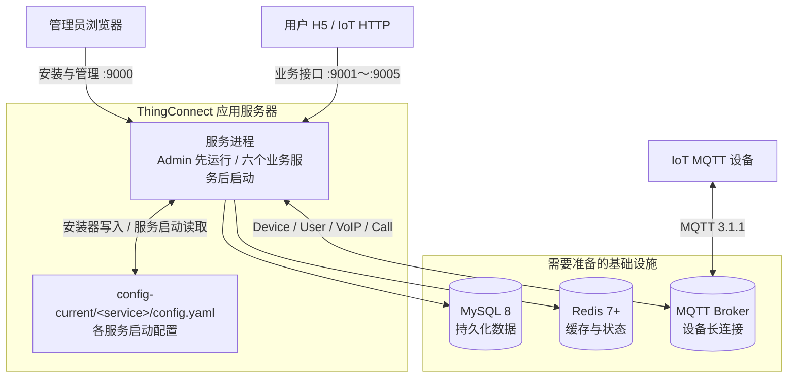

# ThingConnect 安装指南

这份指南适用于 Ubuntu 22.04/24.04，涵盖首次安装、服务验收、业务配置、进程托管、HTTPS、安全收尾和版本更新。默认安装目录为 `/opt/thing-connect`。

从本地工作区部署到 Linux / WSL 做开发联调，见 [本地开发联调部署](deployment-local.md)。

阅读下面的命令时，请先区分几类占位值：

- 浏览器 URL 中的 `127.0.0.1` 指安装服务器本机。从其他电脑访问时，替换为服务器实际 IP。
- 命令中的其他 `127.0.0.1` 表示同机依赖，应按实际部署调整。
- `thing.example.com`、示例账号和密码都要替换。

任何一步失败都应先处理错误，不要跳过检查继续安装。

## 部署顺序

首次部署按下面顺序执行。完成 Web 安装只代表数据库和 Admin 已就绪，业务服务还需要配置和启动。

| 顺序 | 操作 | 完成标志 |
|---|---|---|
| 1 | 按第 2 节准备工具链、MySQL 8、Redis 和数据库账号 | 工具版本正确，数据库与 Redis 连接检查通过 |
| 2 | 按第 3.1 节运行 `install.sh`；Ubuntu 可加 `--install-deps` 准备工具链 | 终端输出安装地址和一次性令牌 |
| 3 | 打开 `http://服务器IP:9000/admin/`，按第 3.2 节检查连接并确认安装 | 安装成功，可以进入 Admin 登录页 |
| 4 | 登录 Admin、绑定 TOTP，发布 `common/tirtc` 和 `user-server/mqtt.connection` | 基础用户服务的必填配置已发布 |
| 5 | 按第 4.2 节启用需要的可选服务，再执行 `service-local.sh start-all` | Admin、Device、User 及选中的可选服务启动成功 |
| 6 | 检查各已启用服务的 `/health/ready`，再完成进程托管、HTTPS 和公网代理 | 健康接口成功，对外入口可访问 |
| 7 | 后续按第 4.6 节执行 `deploy-prod.sh update` | 更新成功；不需要重新运行安装向导 |

如果只需要基础用户服务，第 5 步无需启用任何可选服务。使用 AI、VoIP、Call 或 Recognition 时，先发布该业务的必需配置，再启用。

## 整体架构



| 组件 | 用途 | 安装时要注意什么 |
|---|---|---|
| MySQL | 保存用户、设备、业务数据、动态配置和安装状态 | 迁移账号负责建库、建表和升级；所有服务共用运行账号，生产环境建议使用独立的 DML 账号 |
| Redis | 保存会话、验证码、限频、在线状态和短期协调数据 | Admin 与已启用业务服务连接同一个 Redis 实例和 DB |
| MQTT Broker | 承载设备长连接和实时指令 | Device、User、VoIP、Call、Recognition 分别配置账号；Admin、AI 不直接连接 Broker |
| `config-current/<service>/config.yaml` | 保存进程启动所需的基础配置和共享密钥 | 由安装器生成，不要手工拆分或复制 revision |
| Admin | 首次安装、动态配置和服务状态 | 首次安装只启动 Admin；Admin 不执行主机命令或进程控制 |

MQTT、TiRTC 和普通业务配置通过 Admin 发布并存入 MySQL。业务服务启动时读取阻断配置，运行期间再按注册表中的 reload 策略应用更新。管理员完成必填配置后，需要登录服务器执行页面给出的 `service-local.sh` 命令来启动业务服务。

安装前需要准备 Linux 应用服务器、MySQL 8、Redis 7+，以及首个管理员的邮箱和密码。MQTT、TiRTC、SMTP、人机验证、微信、AI 资源、Nginx 和证书都在 Admin 安装完成后配置。

Nginx、HTTPS 和生产进程托管都不是首次安装页面的前置条件。

## 1. 服务与端口

| 服务 | 默认 HTTP 端口 | 安装要求 |
|---|---:|---|
| `admin-server` | 9000 | 必装，管理后台和配置中心 |
| `device-server` | 9001 | 生成基础配置，完成 MQTT 后由服务器命令启动 |
| `user-server` | 9002 | 生成基础配置，完成 MQTT、TiRTC 后启动，同时提供用户 H5 |
| `voip-server` | 9003 | 生成基础配置，完成 MQTT、TiRTC 后启动 |
| `ai-server` | 9004 | 生成基础配置，完成 TiRTC 后启动 |
| `call-server` | 9005 | 生成基础配置，完成 MQTT、TiRTC 后启动 |
| `recognition-server` | 9006 | 生成基础配置，完成 MQTT 后启动；受理识别任务还需配置千问 Key |

首次安装会构建服务清单中的全部服务，并为 Admin 与六个业务服务生成基础配置。安装结束时只有 Admin 运行；安装器和 Admin 都不会自动启动业务服务。管理员按需完成配置并启用业务服务，`start-all` 只启动启用清单中的服务。

应用端口使用上表默认值。安装页面只填写 MySQL、Redis 及部署访问地址，不在首次安装中任意重排应用端口。业务服务必须在 Admin 就绪且启动前检查通过后启动。

服务清单以 [`internal/installer/service_catalog.tsv`](internal/installer/service_catalog.tsv) 为准。构建脚本、首次安装、本地进程控制、日常发布和安装页面都读取这份清单；安装时，清单和加载器也会发布到部署根目录。

增加业务服务时，需要在清单中登记名称、HTTP 端口、必装或可选、MQTT 依赖、静态资源目录和显示名称，并提供同名 Go 构建入口及可生成、可校验的配置。如果服务还有跨服务配置、动态配置或进程托管要求，也要同步实现对应 adapter、注册表和托管配置，不能只增加一条清单记录。

## 2. 安装前准备

### 2.1 安装构建工具

首次安装只需准备构建工具和外部依赖；反向代理与生产进程托管在安装成功后配置。安装基础工具：

```bash
(
  set -Eeuo pipefail
  sudo apt-get update
  sudo apt-get install -y \
    ca-certificates curl default-mysql-client git \
    redis-tools snapd util-linux
  sudo systemctl enable --now snapd.socket
  sudo snap install go --classic
  sudo snap install node --classic --channel=24/stable
)
```

使用企业软件源或已有工具链时可跳过 `snap install`，但必须满足 Go 1.21+、Node.js 20.19+ 或 22.12+、npm 10+。验证：

```bash
(
  set -Eeuo pipefail
  go version
  node --version
  npm --version
  GO_VERSION="$(go env GOVERSION)"
  awk -v version="${GO_VERSION#go}" '
    BEGIN {
      split(version, part, ".")
      exit !(part[1] > 1 || (part[1] == 1 && part[2] >= 21))
    }
  ' || {
    echo "Go 版本不满足 1.21+: $GO_VERSION" >&2
    exit 1
  }
  node -e '
    const [major, minor] = process.versions.node.split(".").map(Number);
    if (!((major === 20 && minor >= 19) ||
          (major === 22 && minor >= 12) || major > 22)) {
      console.error(`Node.js 版本不满足要求: ${process.versions.node}`);
      process.exit(1);
    }
  '
  NPM_MAJOR="$(npm --version | cut -d. -f1)"
  [ "$NPM_MAJOR" -ge 10 ] || {
    echo "npm 版本不满足 10+: $(npm --version)" >&2
    exit 1
  }
  command -v \
    cp curl flock git go mv mysql mysqldump \
    node npm redis-cli setsid
)
```

安装服务器需要访问 Git 仓库、Go Module 源和 npm Registry。`install.sh` 会自行拉取源码并在服务器上构建二进制、用户 H5 和 Admin Web。

### 2.2 准备依赖和网络

MySQL 和 Redis 可以部署在同机或独立服务器。上述工具安装命令和 `--install-deps` 只准备工具链及数据库客户端，不安装 MySQL/Redis 服务，也不创建账号；先由运维准备可连接的实例，再继续安装。

准备以下信息：

- MySQL 8.0+ 地址、端口、目标数据库名及迁移、运行账号凭据（允许使用同一账号）。
- Redis 7+ 地址、端口、密码和 DB 编号。
- 应用服务器 IP；生产反向代理还需提前确定最终域名和 HTTPS 方案。
- 首个管理员邮箱和密码。密码至少 8 位，且必须包含英文大写字母、英文小写字母和数字；允许同时使用中文和特殊字符。

首次安装时只需允许管理员来源访问 TCP 9000。完成后按实际启用服务允许受信网络访问 9000～9006。MySQL 和 Redis 不应对公网开放；MQTT 仅在公网设备确需连接时开放启用 TLS、强认证和 Topic ACL 的设备接入端口，Broker 管理端口不得开放公网。

直接暴露业务端口会同时暴露该进程的路由面，只适合可信网络或验收。公网部署应使用第 4 节的 Nginx 单一入口，并禁止代理 `/v1/internal/*` 及各业务服务的 `/internal/*`。

### 2.3 准备 MySQL 账号

安装页面分别填写两组凭据，允许使用同一账号；生产环境建议分开配置：

- 迁移账号：创建目标数据库、建表并执行版本化迁移。
- 运行账号：所有已启用服务共用，需要 DML 权限；生产环境建议只授予 DML 权限。

安装器不创建 MySQL 用户、不执行 `GRANT`，因此迁移账号不需要 `GRANT OPTION`。先以 DBA 账号登录：

```bash
export MYSQL_HOST=127.0.0.1
export MYSQL_PORT=3306
mysql -h "$MYSQL_HOST" -P "$MYSQL_PORT" -u root -p
```

在 MySQL 客户端中执行。先替换两个密码；`thing_connect` 必须与安装页面填写的数据库名一致。生产环境应把 `%` 改成应用服务器来源地址：

```sql
CREATE USER IF NOT EXISTS 'thingconnect_migrator'@'%';
ALTER USER 'thingconnect_migrator'@'%'
  IDENTIFIED BY 'replace-with-migration-password';

CREATE USER IF NOT EXISTS 'thingconnect_runtime'@'%';
ALTER USER 'thingconnect_runtime'@'%'
  IDENTIFIED BY 'replace-with-runtime-password';

GRANT CREATE, ALTER, INDEX, SELECT, INSERT, UPDATE, DELETE
ON thing_connect.* TO 'thingconnect_migrator'@'%';

GRANT SELECT, INSERT, UPDATE, DELETE
ON thing_connect.* TO 'thingconnect_runtime'@'%';

EXIT;
```

首次安装只接受不存在或完全无表的专用数据库。迁移账号的库级 `CREATE` 权限允许安装器创建不存在的库；以下独立账号示例中，运行账号只有 DML 权限。如果数据库必须由 DBA 创建，在授权前执行：

```sql
CREATE DATABASE thing_connect
  CHARACTER SET utf8mb4 COLLATE utf8mb4_0900_ai_ci;
```

验证账号可以登录；此时不需要选择目标数据库：

```bash
(
  set -Eeuo pipefail
  export MYSQL_HOST=127.0.0.1
  export MYSQL_PORT=3306
  mysql -h "$MYSQL_HOST" -P "$MYSQL_PORT" \
    -u thingconnect_migrator -p -e "SELECT CURRENT_USER()"
  mysql -h "$MYSQL_HOST" -P "$MYSQL_PORT" \
    -u thingconnect_runtime -p -e "SELECT CURRENT_USER()"
)
```

> 不要手工导入 `scripts/schema.sql`。
>
> - 首次安装只接受不存在或完全无表的专用数据库。发现已有表时，安装器读取结构后停止，不会建表、迁移、补数据、清空或覆盖。
> - 旧版 ThingConnect 数据库应先完成可恢复备份，再按第 4.6 节升级，不要交给首次安装入口。
> - Web 预检先在不选择目标数据库的情况下验证运行账号登录。表结构就绪后，再用不写入业务数据的零行语句逐表检查 DML 权限。

#### MySQL 连接预算

每个服务进程都有独立连接池。启动 YAML 的 `database.max_open_conns` 默认是 `50`（省略或 `0`），`database.max_idle_conns` 默认是 `10`，且不超过连接上限；显式设置空闲连接为 `0` 表示不保留空闲连接。负数或空闲连接大于连接上限会导致启动失败。修改后重启对应服务；这些参数不在 Admin 动态配置中管理。

按所有服务实例的连接池上限之和计算容量，并为迁移、管理、监控和并发测试预留连接。例如，七个服务各设置 `max_open_conns: 10`、`max_idle_conns: 2`，最多占用 70 个连接；MySQL 上限为 100 时剩余 30 个连接供其他任务使用。该示例适用于小型测试环境，生产参数应结合实例数、并发负载和数据库内存评估。

运维时检查 MySQL 的 `max_connections`、账号连接限制，以及 `Threads_connected`、`Max_used_connections`。出现连接耗尽时同时排查连接池总预算、长事务和连接未释放；不要仅提高数据库上限。

### 2.4 验证 Redis

```bash
(
  set -Eeuo pipefail
  export REDIS_HOST=127.0.0.1
  export REDIS_PORT=6379
  read -srp "Redis 密码（无密码直接回车）: " REDISCLI_AUTH
  echo
  export REDISCLI_AUTH
  redis-cli -h "$REDIS_HOST" -p "$REDIS_PORT" PING
  unset REDISCLI_AUTH
)
```

MQTT 凭据在 Admin 安装完成后配置，Device、User、VoIP、Call、Recognition 各用一套。需要注意以下限制：

- Username 模式会结合进程的 `SERVICE_INSTANCE_ID` 生成实际 ClientID。
- 固定 ClientID 不能由多个服务或副本共用。
- 使用 `mqtts://` 时，应用服务器的系统信任库必须能够验证 Broker 证书链。
- 服务启动前会做一次连接认证检查。检查不订阅消息，也不写 Redis；失败时服务保持停止。

TiRTC App ID、Access Key ID 和 Secret Key ID 同样没有可运行默认值。User、VoIP、AI、Call 在启动前要求该配置已经由 Admin 发布。

## 3. 首次安装

### 3.1 下载并运行安装脚本

以下命令只下载首次安装入口。脚本会把完整仓库克隆到 `/opt/thing-connect/tirtc-server-example`：

```bash
(
  set -Eeuo pipefail
  curl -fsSLo /tmp/thing-connect-install.sh \
    https://raw.githubusercontent.com/tangeai/tirtc-server-example/main/thing-connect/scripts/install.sh
  bash -n /tmp/thing-connect-install.sh
  chmod 0755 /tmp/thing-connect-install.sh
  sudo env \
    PATH=/usr/local/sbin:/usr/local/bin:/usr/sbin:/usr/bin:/sbin:/bin:/snap/bin \
    /tmp/thing-connect-install.sh
)
```

使用其他工具链目录时，把它显式加入上述受控 `PATH`，不要把未经检查的用户 `PATH` 整体传给 `sudo`。

私有镜像仓库或自定义目录使用环境变量，不要修改脚本：

```bash
sudo env \
  PATH=/usr/local/sbin:/usr/local/bin:/usr/sbin:/usr/bin:/sbin:/bin:/snap/bin \
  REPO_URL=git@example.com:team/tirtc-server-example.git \
  DEPLOY_ROOT=/opt/thing-connect \
  /tmp/thing-connect-install.sh
```

`install.sh` 依次执行：

1. 取得部署锁，检查工具链版本、安装状态和安装端口；未完成安装进入恢复流程。
2. 克隆仓库；已有干净工作树时只允许 `git pull --ff-only`。
3. 按服务清单完整构建所有服务和 Web 静态资源。
4. 发布首次运行所需的二进制、静态资源、服务清单和本地服务脚本。
5. 生成只显示一次的安装令牌，通过本地启动脚本启动 Admin 安装模式。

Ubuntu 使用 `sudo env PATH=/usr/local/sbin:/usr/local/bin:/usr/sbin:/usr/bin:/sbin:/bin:/snap/bin /tmp/thing-connect-install.sh --install-deps` 可安装缺少的基础工具及 Go、Node Snap。已有 Snap 工具链保留；版本不符合要求时按报错升级。MySQL、Redis 和第三方账号仍需提前准备。

安装中断后，使用相同 `DEPLOY_ROOT` 再次执行安装入口。已有安装状态时复用已发布文件；尚未提交配置时停止旧安装进程、生成新令牌并恢复页面，旧令牌失效。配置已经提交时启动 Admin 完成恢复；安装完成时提示使用更新入口。恢复文件不完整时保留现场并报出缺失项，不删除配置或数据库。

脚本不配置反向代理、HTTPS、开机自启或日志轮转，也不复制示例配置。

### 3.2 完成 Web 安装

在安装服务器本机的浏览器打开：

```text
http://127.0.0.1:9000/admin/
```

从其他电脑访问时，把 `127.0.0.1` 替换为安装服务器实际可达的局域网或公网 IP。

安装端口默认监听所有网卡，所有写操作都要求终端输出的一次性令牌。安装完成前，仍应通过安全组或防火墙把 9000 限制到管理员来源。不要把令牌发送到聊天、工单或监控系统。

安装页面依次填写：

1. MySQL 主机、端口、专用数据库名、迁移账号和 DML 运行账号。
2. Redis 主机、端口、密码和 DB。
3. 首个管理员账号。
4. 统一对外访问地址、可信代理和 HTTPS Cookie。生产环境即使稍后才配置 Nginx，也应填写最终的 `https://` 地址并勾选 HTTPS Cookie；只做本机或可信内网直连验收时可以留空并关闭 HTTPS Cookie。同机 Nginx 使用默认可信代理 `127.0.0.1`。

页面不要求 MQTT、TiRTC 或业务服务选择。安装器始终生成六个业务服务的基础配置，但只启动 Admin。

先执行“连接检查并生成安装计划”，核对数据库动作，再确认安装：

| 数据库状态 | 安装器行为 |
|---|---|
| 不存在 | 创建数据库并初始化表 |
| 已存在且无表 | 初始化表 |
| 本机同一操作标识的中断任务 | 只恢复该未完成任务，不接管其他数据库 |
| 其他任何已有表的数据库 | 只读识别后拒绝，不建表、迁移、补数据、清空或覆盖 |

预检或安装失败时，页面会保留失败阶段、具体依赖和处理建议，无需打开浏览器开发者工具。修复地址、账号授权或 TLS 后再重试。服务端日志记录脱敏后的详细原因，页面不会显示密码、内网连接串或上游客户端原始错误。

安装器会生成以下密钥，并以 `0600` 权限写入带摘要校验的一次性配置 revision：

- 业务服务共享的 JWT 密钥
- 已安装服务共享的 `internal.key`
- Admin JWT 密钥
- MFA 加密密钥

数据库提交和配置激活都有恢复记录。安装中断后，应使用同一部署目录和数据库继续，不要删除表，也不要手工改写 `config-current`。

令牌丢失且尚未提交配置时，可重新运行：

```bash
sudo env \
  PATH=/usr/local/sbin:/usr/local/bin:/usr/sbin:/usr/bin:/sbin:/bin:/snap/bin \
  /opt/thing-connect/install.sh
```

配置已经激活但安装未结束时，重启 Admin 会自动完成本机同一安装任务的对账，但不会拉起业务服务。返回安装页面，输入一次性令牌并完成 Admin 安装。不要删表、删配置或重新安装。

## 4. 安装后必须完成

### 4.1 在 Admin 发布启动必需配置

首次登录 Admin Web 时绑定 TOTP，并把恢复码离线保存。然后在配置中心发布：

| 服务 | 启动前需发布的配置 |
|---|---|
| Device（必需） | 发布独立 MQTT 连接，用于维护设备在线状态 |
| User（必需） | `common/tirtc`、`user-server/mqtt.connection` |
| AI（按需启用） | `common/tirtc`；角色和资源按业务需要配置 |
| VoIP（按需启用） | `common/tirtc`、`voip-server/mqtt.connection`；使用微信通话还需配置微信应用 |
| Call（按需启用） | `common/tirtc`、`call-server/mqtt.connection` |
| Recognition（按需启用） | `recognition-server/mqtt.connection`；使用模型能力还需配置模型 Key |

各 MQTT 服务使用独立账号或 ClientID。未使用的可选业务无需为了启动基础服务而填写配置。

MQTT 配置表单提供“测试连接”和“测试并发布”两个操作：

- “测试连接”使用尚未发布的表单值，从 Admin 服务器检查 Broker 网络、TLS 和账号认证。
- “测试并发布”先执行同样的检查，成功后才写入数据库。
- 固定 ClientID 模式使用临时连接 ID 测试，避免挤掉正在运行的同名客户端。

检查失败时，页面会提示 Broker 可达性、证书、凭据或来源授权问题。业务服务启动预检仍会使用正式 ClientID 做最终确认。

Admin 的服务状态页显示每个服务缺少的配置及原因；配置齐全时显示可复制的服务器启动或重启命令。Admin 只提供状态和指引，不执行主机进程命令。

普通运行时配置发布后会热加载。MQTT 和 TiRTC 在页面中标记为“需重启”，发布后应执行页面给出的重启命令。

TiRTC 配置只检查字段完整性和格式，业务服务启动预检会再确认配置可以读取。目前没有一种既能证明凭据有效、又不会产生业务副作用的通用在线测试。SMTP、人机验证、微信应用和 AI 资源按实际需要发布。

动态配置没有数据库记录时，使用后端注册表默认值；MQTT 和 TiRTC 没有可运行默认值，必须显式发布。

普通配置和密钥以明文 JSON 存储在 MySQL。Admin Web 默认用 `*` 遮盖密钥，具备权限的管理员可以查看原值，因此必须限制数据库和备份的访问范围，并启用审计。

### 用户页面语言

海外独立站在 Admin 的用户服务、AI 服务和呼叫服务配置页分别将 `web.language` 的默认语言设为 English。允许用户切换时，同一站点内沿用浏览器记住的手动选择；禁止切换时，按当前服务的默认语言展示。配置发布后在下次打开页面时生效，实例应用版本可在服务状态页查看。

未发布后台语言配置时，各服务使用自身 YAML 的 `web.language.default` 和 `web.language.allow_switch`；省略时为 `auto` 和 `true`。语言配置不改变启动时对 Admin 的依赖。英文页面翻译界面和操作提示；邮件模板、AI 对话语言以及云端资源描述需要单独配置。

官网上线时，在 Admin 的用户服务配置中设置 `web.site.public_url` 为正式 HTTPS 根地址，并填写站点名称。反向代理将 `/`、`/boards`、`/boards/<detail_slug>`、`/getting-started`、`/faq`、`/guides/simulator`、`/guides/wechat-voip`、`/guides/linux-device`、`/robots.txt`、`/sitemap.xml` 交给 user-server，避免以静态 `index.html` 替代服务端页面。首页 HTML 包含核心能力、体验步骤和前三块已上架开发板；开发板页包含无脚本目录，独立详情页使用后台配置的详情标识作为地址，展示已上架型号的适配状态和接入资源。接入指南与常见问题可在无 JavaScript 环境阅读；常见问题的结构化数据与页面答案一致。站点地图包含公开内容页和已上架开发板；下架详情返回 404，目录依赖暂时不可用时站点地图返回 503 并提示稍后重试。标题、描述、Open Graph 和 JSON-LD 随站名配置生成；正式网址用于 canonical 和站点地图，避免使用请求 Host 推断网址。未配置网址时 `/sitemap.xml` 返回 404。登录及设备等用户页面发送 `X-Robots-Tag: noindex, nofollow`。搜索收录和 AI 引用由相应平台决定。

上线验收时，直接获取上述地址的 HTML，确认正文、canonical 正式域名与 JSON-LD 无需运行 JavaScript 即可读取；检查站点地图中的每个地址返回 200，已下架型号返回 404。使用手机和桌面浏览器验证接入指南、常见问题及开发板详情入口，保留原有 `/boards#<detail_slug>` 弹窗链接的可用性。在搜索平台站长工具中提交正式站点地图并检查收录；抓取、索引与 AI 引用结果需通过平台数据持续观察，不能仅凭页面标签判断。

#### 公开页面验收与效果观察

部署后从仓库的 `thing-connect/` 目录运行只读验收：

```bash
python3 scripts/check-public-site.py --base-url https://你的正式域名 --json-output /tmp/public-site-check.json
```

脚本检查 robots、站点地图、所有地图地址的 HTTP 状态、canonical、标题与描述、原始 HTML 正文、JSON-LD、分享元数据，以及登录和设备页面的 noindex。失败时返回非零退出码；可以接入部署后的验收任务。响应时间和字节数仅用于定位单次请求，不代表 Core Web Vitals 或搜索排名。

- `/robots.txt` 返回 404：当前代码始终提供该路由，应检查正在运行的 user-server 版本、反向代理和 CDN 规则。
- `/sitemap.xml` 返回 404、页面缺少 canonical：检查公开接口 `/v1/config/site` 的 `public_url`，再到 Admin 配置 `web.site.public_url`。不要使用请求 Host 或猜测的域名生成正式地址。
- 站点地图返回 503：先恢复目录依赖，再重新验收；不要把临时失败的空目录当作已下架内容。
- `/guides/*` 返回 404：检查已部署版本和根路径到 user-server 的转发。三个教程使用服务端 HTML，页面内容、来源链接和命令无需 JavaScript 即可读取。教程目前提供简体中文内容。

开发板详情的“资料更新”与站点地图 lastmod 使用目录记录的真实更新时间，不能作为固件发布日期或实机验证日期。版本、已知限制和测试结论应在对应的固件说明、源码或烧录指南中记录，并标明型号、版本、环境、步骤和结果；没有测试证据时不填写延迟、稳定性或量产结论。

完成 HTTP 验收后，在有权限的 Google Search Console、Bing Webmaster Tools 等站长工具中验证域名并提交 `/sitemap.xml`。分别观察收录页面、非品牌查询的曝光与点击，以及平台提供的 AI 引用报告；某个平台的引用数据不代表其他平台。站点未接入第三方访问统计时，不能从页面代码推断访问量或用户转化。

需要评估内容价值时，可在选定的统计系统中关联教程访问、固件下载、开始体验与设备绑定成功等事件。下载点击与绑定成功应分别统计；报表只保留所需的汇总信息，不采集验证码、设备凭证、token 或原始请求体。先建立数据基线，再决定英文独立内容、更多教程或性能专项的投入范围。

### 4.2 在服务器预检并启动业务服务

首次安装的 `/opt/thing-connect/enabled-services` 只启用 Admin、Device、User。VoIP、AI、Call、Recognition 的配置文件可以存在，但需要先在 Admin 发布该业务的必需配置，再显式启用。例如启用 AI：

```bash
sudo /opt/thing-connect/service-local.sh enable ai-server
sudo /opt/thing-connect/service-local.sh start-all
curl -fsS http://127.0.0.1:9004/health/ready
```

`disable ai-server` 保存停用状态并停止服务；必需服务不能停用。没有启用清单的旧安装保留按已有配置启动的行为。`enable` / `disable` 适用于本地进程管理；Supervisor 部署还需同步其进程定义，避免两个管理器混用。


需要的配置发布后，在安装服务器执行：

```bash
sudo /opt/thing-connect/service-local.sh start-all
```

`start-all` 先确认 Admin readiness，再依次检查已启用业务服务：

- 基础 YAML 和 Admin 启动阻断配置
- MySQL 连接及 schema 版本
- Redis 连接
- 对应服务的 MQTT 账号认证

首次启动的预检失败时，待启动业务服务保持停止，终端会显示原因和处理建议。预检不会执行数据库迁移，也不会修改业务数据。

逐个启动可用于排查。`start` 本身不保存启用状态；可选服务先执行 `enable`，后续 `start-all` 和更新才会管理它：

```bash
sudo /opt/thing-connect/service-local.sh start thing-connect:device-server
sudo /opt/thing-connect/service-local.sh start thing-connect:user-server
# 例如需要多人对讲时，先完成 Call 配置，再启用和启动：
sudo /opt/thing-connect/service-local.sh enable call-server
sudo /opt/thing-connect/service-local.sh start thing-connect:call-server
```

启动完成后检查进程和已启用服务的直接端口：

```bash
(
  set -Eeuo pipefail
  sudo /opt/thing-connect/service-local.sh status-all
  curl -fsS http://127.0.0.1:9000/health/ready
  curl -fsS http://127.0.0.1:9001/health/ready
  curl -fsS http://127.0.0.1:9002/health/ready
)
```

安装服务器本机的直接入口：

- Admin Web：`http://127.0.0.1:9000/admin/`
- 用户 H5：`http://127.0.0.1:9002/`
- Device API 基础地址：`http://127.0.0.1:9001/v1/device`，验收时调用 API Reference 中的具体接口。
- VoIP、AI、Call API：分别使用 9003、9004、9005。

从其他电脑验收时，把上述 `127.0.0.1` 替换为服务器实际 IP。

`/health/live` 只表示进程存活；`/health/ready` 才表示必需依赖和数据库版本满足要求。

安装器使用的本地服务脚本可用于首次验收、故障排查，以及未接入独立进程管理器时的本机运行：

```bash
sudo /opt/thing-connect/service-local.sh status-all
sudo /opt/thing-connect/service-local.sh start-all
sudo /opt/thing-connect/service-local.sh stop-all
sudo /opt/thing-connect/service-local.sh restart thing-connect:admin-server
```


该脚本不注册开机服务，也不提供日志轮转。长期运行时，运维环境需要另外负责开机启动、日志收集和轮转；具体做法见 4.3 节。

本地服务脚本可能显示以下状态：

| 状态 | 含义与处理 |
|---|---|
| `RUNNING` | 服务已通过进程存活检查 |
| `STARTING` | 守护脚本存在，但服务尚未开始监听 |
| `CONFLICT` | 检测到历史遗留的多个守护进程；先执行对应服务的 `stop`，再检查端口和日志 |

同一服务的守护进程使用独占锁。PID 文件丢失时，脚本会扫描并接管原守护进程，不会再启动一份。

### 4.3 可选：接入生产进程托管

不要求安装 Supervisor。可以继续用 `service-local.sh` 管理服务并由更新脚本自动停启及验收；需要开机自启、集中日志时，再接入 systemd、Supervisor、容器平台或其他现有编排系统。托管配置必须满足以下约束：

- 切换前执行 `sudo /opt/thing-connect/service-local.sh stop-all`，确认本地脚本管理的进程已停止，再启动新的进程管理器。
- Admin 先启动并达到 `/health/ready`，再预检并启动已启用的业务服务。
- 每个进程使用安装器生成的对应 `config-current/<service>/config.yaml`，不要复制或手工拆分配置 revision。
- 每个进程设置稳定且唯一的 `SERVICE_INSTANCE_ID`；Username MQTT 模式依赖它生成不冲突的连接 ClientID。
- 向进程发送 `SIGTERM` 并留出优雅退出时间，不使用强制终止作为正常重启方式。
- 对全部业务服务执行 readiness 检查；`/health/live` 不能替代 `/health/ready`。
- 部署环境负责异常重启、开机自启、日志收集和日志轮转，且同一服务同一实例不能同时被两个进程管理器拉起。
- 安装产物默认归 `root` 所有。改用非 `root` 运行账号时，只调整该账号必需的配置读取、日志和任务目录权限，并继续保护 `0600` 配置中的数据库与服务密钥。

### 4.4 可选：配置 Nginx 单一入口

直接端口已经可以使用，Nginx 不是首次安装条件。需要域名、统一 80 端口或公网隔离内部路由时再安装：

```bash
(
  set -Eeuo pipefail
  export THING_DOMAIN=thing.example.com
  [ "$THING_DOMAIN" != "thing.example.com" ] || {
    echo "请先替换 THING_DOMAIN" >&2
    exit 1
  }
  sudo apt-get update
  sudo apt-get install -y nginx
  cd /opt/thing-connect/tirtc-server-example/thing-connect
  sudo install -m 0644 deploy/nginx/thing-connect.nginx.conf \
    /etc/nginx/conf.d/thing-connect.conf
  sudo sed -i "s/thing\.example\.com/$THING_DOMAIN/g" \
    /etc/nginx/conf.d/thing-connect.conf
  sudo nginx -t
  sudo systemctl enable --now nginx
  sudo systemctl reload nginx
)
```

[Nginx 模板](deploy/nginx/thing-connect.nginx.conf)使用一套公网入口分发请求：

| 路径 | 去向 |
|---|---|
| `/admin/`、`/v1/admin/` | Admin |
| 各业务 API | 对应业务服务 |
| 其他路径 | User H5 |
| 所有内部接口 | 明确拒绝，不向公网代理 |

用户控制台使用 React、TypeScript 和 Vite，源码位于 `user-server/user-web`，构建产物位于 `user-server/static/app`，由 user-server 提供。登录、设备、联系人、角色、多人对讲和实时查看使用同一个应用入口；首页和开发板目录由 user-server 服务端渲染，协议政策为静态内容页。AI、通话等业务服务提供 API，用户页面使用同源 `/v1/*` 地址调用；Admin Web 保持独立的管理入口和权限体系。

`./build.sh user-server` 包含用户前端构建。单独开发前端可执行 `npm --prefix user-server/user-web ci`、`npm --prefix user-server/user-web run dev`，浏览器打开 `http://localhost:5174/login`。Vite 开发代理连接本机默认业务端口，生产环境使用上述 Nginx 分发；不能只启动 user-server 就访问其他服务的业务 API。

角色页入口为 `/agent?device_id=...`，多人对讲入口为 `/room?device_id=...`。旧入口 `/v1/ai/agent` 与 `/v1/call/group/page` 保留同源跳转，查询参数及浏览器片段继续传递。小程序内嵌页与浏览器页面使用相同入口；设备端 API 和 MQTT 协议不依赖页面构建产物。

模板属于运维配置，`install.sh` 不会把它写入系统。Nginx 与服务同机时，安装页面中的 `trusted_proxies` 使用默认值 `127.0.0.1`，不要填写 `0.0.0.0/0`。

模板只监听 80，不申请或管理证书。已有证书时自行增加 443、证书路径和 HTTP 跳转，再执行 `sudo nginx -t && sudo systemctl reload nginx`。安装页面填写的统一对外访问地址和 HTTPS Cookie 必须与最终入口一致，不能只改 Nginx。

HTTP 会明文传输管理员登录信息和会话 Cookie。公网生产环境应在 Nginx 或上游负载均衡器启用 HTTPS。

### 4.5 完成安全与运维收尾

正式开放服务前逐项确认：

- 公网只开放反向代理入口和确有需要的 MQTT TLS 设备接入端口；MySQL、Redis、Broker 管理端口、应用服务直连端口和各服务内部接口不直接暴露公网。
- 公网入口启用 HTTPS，Admin 配置中的 `cookie_secure` 与实际协议一致。
- 安装期间使用过的临时令牌、高权限数据库凭据和初始密码不进入聊天、工单、Shell 历史或监控；发生暴露时立即轮换。
- `config-releases`、`config-current`、`var/installer`、Admin 任务目录和数据库备份只允许受信运维账号读取。
- 为 MySQL 数据、激活配置和安装状态建立定期备份，并在隔离环境验证恢复；配置备份包含明文密钥，必须加密和限制访问。
- 监控全部服务的 `/health/ready`、进程重启次数、磁盘空间、MySQL/Redis/MQTT 可用性，并配置日志收集和轮转。
- 使用非管理员账号完成一次用户注册、设备接入和已启用业务能力的端到端验收，不能只以进程存活作为安装完成标准。

完成以上检查后，首次安装流程结束。

### 4.6 版本更新与数据库升级

`build.sh` 为同一批服务注入统一的程序版本。通过 `BUILD_VERSION=v1.2.3 ./build.sh` 可指定发布版本号；未指定时，干净工作区且当前提交恰好对应 Git 标签则使用标签，否则使用精确到秒的 UTC 构建时间。后台将时间转换为浏览器本地时间展示，并保留 Git 提交号用于排查。构建时间不是服务启动时间；旧程序只有提交号时显示“历史构建（未记录时间）”，重新构建并部署后才会带上时间。配置修订号 `rN` 独立表示动态配置的发布次数，不作为程序版本。


两个脚本用途不同：

| 脚本 | 使用场景 |
|---|---|
| `install.sh` | 开发者首次安装 ThingConnect |
| `deploy-prod.sh` | ThingConnect 维护者在约定的生产目录、服务清单和进程管理方式下持续发布 |

其他部署环境可以参考 `deploy-prod.sh` 的构建、迁移和发布流程，但要按自身目录、权限和服务管理方式调整，不要把它当作通用安装器。

在符合该生产目录约定的环境中执行维护发布：

```bash
sudo /opt/thing-connect/deploy-prod.sh update
```

完整发布成功后，脚本会在部署根目录原子记录 Git commit 和已安装服务集合。再次更新时先快进拉取源码，再按下面的条件决定是否继续：

| 当前状态 | 处理方式 |
|---|---|
| commit 和服务集合都没变化，且所有服务已有配置 | 输出“当前已发布版本与待发布版本一致”，直接结束 |
| 首次使用发布工具，或发布状态缺失、损坏 | 执行完整更新 |
| 已安装服务集合发生变化 | 执行完整更新 |
| 辅助发布文件没有完整刷新 | 执行完整更新 |

直接结束时，脚本不会检查 Supervisor 或停服状态，也不会安装依赖、构建、备份、检查数据库或重启服务。脚本不根据目录时间或运行中的进程猜测发布版本。

需要在同一 commit 下重新构建或修复发布文件时显式执行：

```bash
sudo env FORCE_UPDATE=1 /opt/thing-connect/deploy-prod.sh update
```

进入完整更新后，脚本先构建新版本，为已启用服务创建部署目录。缺少 `config.yaml` 时复制该服务的 `config.yaml.example`，权限设为 600；已有独立配置或激活配置包保持不变。模板仍含必填占位值时，校验会停止发布，请填写实际生产配置后重新执行 `update`；此时不会替换运行中的程序或执行数据库迁移。相同 commit 下缺少服务配置也会执行此补齐流程。高级 `build` 命令同样在完整构建成功后准备目录和缺失配置。

联系人备注与角色关联保护依赖当前完整 schema：`voip_device_auth.device_remark`、`voip_remark_outbox`、`ai_user_role.deleting` 和 `ai_cloud_role_ref`。部署应按完整更新流程迁移并统一更新服务，不能仅替换联系人页面或单个服务。运行账号需要这些新表的 DML 权限。设备 HTTP/MQTT 协议保持兼容，无需同时升级设备固件。旧共享备注保留在数据库中，但不迁移、不作为展示回退；独立备注未设置时为空。

配置有效后，脚本重新检查服务托管清单，再检查数据库所有权、完整结构和待迁移版本。检查过程只读，优先使用显式 `MIGRATION_CONFIG` 或已有 `admin-server/migration-config.yaml`；未配置独立迁移账号时使用 Admin 当前运行配置。数据库已经是当前版本时，脚本输出“数据库已是当前版本”，跳过数据库备份门槛和 DDL，代码与静态资源仍会继续发布。停服前还会使用新版本 Admin 程序检查已启用业务的必填动态配置和 MySQL、Redis、MQTT 连接，失败时保留原进程。存在待执行迁移时，依赖预检在迁移后、业务启动前执行。

需要迁移时，准备独立配置文件。首次使用可以从当前 Admin 配置复制，保留主机、端口、数据库名及其他字段，只把 `database.dsn` 中的用户名和密码改为第 2.3 节准备的迁移账号：

```bash
# 仅在 migration-config.yaml 尚不存在时复制，避免覆盖已有迁移凭据。
sudo test -e /opt/thing-connect/admin-server/migration-config.yaml || \
  sudo install -m 600 /opt/thing-connect/config-current/admin-server/config.yaml \
    /opt/thing-connect/admin-server/migration-config.yaml
sudoedit /opt/thing-connect/admin-server/migration-config.yaml
sudo chmod 600 /opt/thing-connect/admin-server/migration-config.yaml
```

手动部署未使用 `config-current` 时，从实际使用的 Admin `config.yaml` 复制。不要修改业务服务的运行账号，也不要把迁移配置指向其他数据库。安装页面填写的迁移密码不会自动保存成这个文件。

存在待执行迁移时，脚本在停服前要求具备 DDL 权限的独立 `MIGRATION_CONFIG` 和可恢复的数据库备份。使用 `mysqldump` 生成完整备份，在隔离 MySQL 实例完成恢复演练，再把绝对路径和恢复验证声明传给更新命令：

```bash
sudo env \
  MIGRATION_CONFIG=/opt/thing-connect/admin-server/migration-config.yaml \
  DATABASE_BACKUP_FILE=/secure/backups/thing-connect-before-update.sql \
  DATABASE_BACKUP_RESTORE_VERIFIED=1 \
  /opt/thing-connect/deploy-prod.sh update
```

存在待执行迁移时，脚本会确认备份文件存在、非空且可读，并记录 SHA-256。缺少备份或未声明恢复验证时，脚本会在执行任何 DDL 前停止；只读迁移检查失败也会停止发布。

`SKIP_MIGRATIONS=1` 只适用于 DBA 已通过独立受控流程完成同一版本迁移的环境，不能用来绕过备份。

该命令取得部署锁后快进拉取源码，重新加载新版本服务清单，构建全部服务，备份当前文件，并按嵌入迁移目录执行缺失数据库版本。迁移版本从 `core/NNN_*.sql` 和 `admin/NNN_*.sql` 自动发现；增加表或修改表时不需要改安装脚本中的版本号。数据库迁移不能随旧二进制自动回滚。

`deploy-prod.sh` 会自动识别服务管理方式：

| 环境 | 发布方式 |
|---|---|
| Supervisor 中包含全部已启用服务 | 预检完成后停止服务，迁移、发布，再按 Admin 优先顺序启动并检查 readiness |
| 没有 `supervisorctl`，或没有任何 ThingConnect 条目 | 使用 `service-local.sh` 自动完成相同停启和验收流程 |

普通更新只需执行 `deploy-prod.sh update`。构建、基础配置校验和依赖连接预检失败时保留运行中的服务；停服后的发布失败触发文件恢复。数据库结构已经变化时，失败会保持整个服务组停止，需人工恢复数据库或确认兼容性，不能直接启动旧版本。

`SERVICE_MANAGER=local` 和 `SERVICE_MANAGER=supervisor` 可明确指定管理器。Supervisor 只配置部分已启用服务时拒绝发布。使用 systemd、容器等外部编排时可显式选择 `SERVICE_MANAGER=manual`，自行完成 stop-all、更新、start-all 和健康检查；该模式要求服务事先停止，并且没有冲突的 Supervisor 条目。

新版本增加服务时，需要同时更新：

- 服务清单
- 可生成、可校验的基础配置
- Admin 动态配置注册表
- 服务器预检
- 进程托管和 readiness

表结构变化还要增加有序、可重入的迁移，并更新 `scripts/schema.sql`。

Supervisor 部署在发布前执行 `supervisorctl reread` 和 `supervisorctl update`。缺少任何已启用服务的进程定义时，发布会在修改文件和数据库前停止。使用手动模式、systemd、容器平台或其他编排系统时，也要提供等价的显式迁移、Admin 优先启动和 readiness 门槛。

### 升级遇到新增必填配置

当新版增加了旧 Admin 无法编辑的必填配置时，`update` 会提供配置阶段，退出码为 `78`，不记录完整发布成功：

- 数据库结构已是目标版本时，只更新并启动新版 Admin，现有业务服务保持运行。
- 数据库需要迁移时，先按正常发布流程停服、迁移和替换文件，再启动新版 Admin；业务配置未完成时，业务服务保持停止。
- 登录新版 Admin，填写、测试并发布提示的配置，再执行同一条 `update` 命令完成发布。不要将 MQTT 连接的 ClientID 与仍运行的其他服务重复使用。
- Admin 发布或就绪检查失败时执行对应回滚流程；数据库结构已变化时不自动恢复旧二进制。手动服务管理模式需由运维启动已更新的 Admin。

配置阶段不绕过业务服务的必填配置和依赖检查，也不会直接复制其他服务的 MQTT 身份。`deploy-local.sh update` 使用相同流程；若部署入口来自旧版本，应确保它打包的本地源码包含此发布流程。

### 4.7 失败后从哪里继续

| 停止位置 | 处理后继续执行 |
|---|---|
| 工具缺失、版本过低或构建失败 | 修复工具链或下载网络，重跑同一个安装/更新命令；构建日志按终端给出的路径查看 |
| 安装页面尚未完成、令牌丢失 | 使用同一目录再次执行 `install.sh`，按第 3.2 节恢复，不删表或配置 |
| 必填配置缺失（退出码 78） | 登录配置阶段提供的新版 Admin，补齐、测试并发布，再重跑 `update`；首次安装按安装流程启动 |
| MQTT 认证或依赖连接预检失败 | 检查连接地址、账号及网络，修复后重跑 `update` |
| 提示需要数据库迁移 | 准备独立迁移配置及可恢复备份，使用第 4.6 节带参数的命令重试 |
| 数据库结构已变化后发布失败 | 保持服务停止，先恢复数据库备份或确认版本兼容性，再处理文件回滚；不能直接启动旧二进制 |
| 服务启动或 readiness 失败 | 查看 `/opt/thing-connect/logs/<服务名>.err.log` 和 `.out.log`，按错误修复；不要只凭 `RUNNING` 判断就绪 |

## 5. 相关文档

Admin 功能、RBAC、配置中心和任务说明见 [Admin Server README](admin/admin-server/README.md)。业务接口见 [API Reference](api-reference.md)，设备接入流程见 [设备接入指南](device-integration.md)。

### 用户 Web 顶部链接与账号菜单

在 Admin 的 User Server 配置中选择“顶部导航链接”（`web.navigation`），可添加最多 3 个链接，填写名称和 HTTP(S) 地址，并通过上移、下移调整顺序或停用链接。名称最多 20 个字符；地址不允许包含账号密码。发布后用户刷新设备页生效，未配置或全部停用时不显示导航入口。电脑端直接展示，手机端收进“相关链接”；链接均在新标签页打开。

未发布此配置时使用 user-server YAML 的 `navigation.links`，省略时为空列表；发布空列表可显式隐藏 YAML 中的链接。该配置无密钥、作用域为全局、支持运行时应用，revision 通过服务状态及公开导航接口观察。

设备页右上角头像显示账号菜单，可查看当前登录邮箱、进入邮箱验证码修改密码流程或退出登录。登录失效后进入登录页并显示“登录状态已失效，请重新登录”。

## 独立 AI识别服务

`recognition-server` 是独立业务服务，默认端口9006，与 ai-server、voip-server、call-server 并列。生产发布脚本构建后会创建其部署目录，并在缺少配置时复制模板；请填写生产配置再继续发布。安装服务清单及构建脚本包含该服务；启用时需要相同 MySQL/Redis、共享 jwt_secret/internal.key 和独立 MQTT 连接身份。Admin 不与业务服务共用管理员 JWT。

数据库迁移需包含 recognition 类型/任务/语音/用量/outbox 表及 device_bind.binding_revision 字段。按本文件既有备份、迁移和 readiness 流程执行；运行账号不需要 DDL 权限。配置模板在 recognition-server/config.yaml.example。

Nginx 模板将 /v1/recognition/ 转发到9006并拒绝内部路径。/services 可通过 user-server 的 discovery.recognition_server_url 返回 recognition-srv；旧配置省略此字段时不影响原服务发现。统一代理部署下用户设备页面请求站点同源 /v1/recognition/。

Admin 中配置识别服务 MQTT、千问默认 Key 及接口地域；只用音频识别无需配置 TiRTC 凭证。/health/ready 检查 MySQL、Redis 和 MQTT，缺少千问 Key 会拒绝新任务而不阻止配置管理。服务状态名称 recognition-server，动态模型配置 revision 随心跳上报。


### 设备在线状态消费与升级验收

Device 服务单实例订阅 `device/+/up`、`$SYS/brokers/+/clients/+/connected` 和 `disconnected`，维护 `online:{clientID}`，有效期为 150 秒。Broker 需要发布 EMQX 系统连接事件，并授权 Device 账号订阅；临时绑定连接依赖连接事件。User、VoIP、Call、Recognition 保留下行和 ACK 能力，通过 Redis 查询在线状态，不订阅全量设备心跳。

若 Device 启动日志出现 `presence subscription rejected`，表示 MQTT 连接认证成功但必需主题未获订阅授权。按日志中的 `topic` 检查 Broker 的实际授权源，为 Device 专用账号允许订阅 `device/+/up`、`$SYS/brokers/+/clients/+/connected`、`$SYS/brokers/+/clients/+/disconnected`。EMQX 文件授权示例见 `deploy/emqx/device-acl.conf`，规则需位于通用拒绝规则前；使用数据库、HTTP 或云端授权时在对应授权源配置相同权限。还须启用 Broker 系统连接事件发布。Device 启动预检验证三个主题的 SUBACK，权限不足时在停服前拒绝完整更新；仅在 Admin 中保存账号密码不代表主题权限已配置。

当前在线状态消费者要求 **Device 单实例**。不要直接复制 Device 进程来实现高可用；多消费者分片、接管和连接代次隔离需要另行实现和压测。现有设备心跳不带连接代次，因此不使用无法确认连接代次的断开事件删除在线记录，避免迟到断开误删新连接。离线由心跳 TTL 判定，最后一次有效观测后最多等待 150 秒；这不提供完整事件代次隔离，也不代表十万设备容量已经验收。

升级前先执行 core 12 数据库迁移，再更新 Admin 并发布 `device-server/mqtt.connection`，确保 Device 账号具备上述订阅权限，再启动 Device 消费者并滚动更新其余 MQTT 服务。旧版本使用持久会话，账号和 ClientID 保持不变时，新进程会在每次连接后主动退订旧心跳和系统事件订阅；若同时更换身份，需在 Broker 管理端清理旧身份会话。验收应检查 Broker 中只有 Device 订阅全量设备状态，并确认正式设备心跳、临时绑定、下行 ACK 与断线状态处理正常。回滚消费归属时应按同样顺序保证至少一个消费者工作，避免全量停收窗口。数据库版本保护会拒绝直接启动只支持 core 11 的旧二进制；回滚需要保留 core 12 兼容性的构建，不能删除迁移记录来绕过检查。

心跳按最多 256 条或 100 毫秒批量写入 Redis；内存接收队列最多 16384 条，存储失败时有界等待并按原顺序重试。队列溢出、存储写入持续失败或 MQTT 订阅失败会使 Device readiness 不通过，并记录错误。MQTT 订阅或退订失败时，连接恢复任务以 1 至 30 秒有界退避重试，成功前 readiness 不通过，任务随连接关闭退出。心跳有效期按原始观测时间计算，重试不会延长过期心跳；应用服务器与 Redis 必须保持时钟同步。在线查询接口仍沿用现有 Redis 读取语义，不能把其他服务 Redis 可达等同于状态消费者健康；运维必须同时监控 Device readiness。

设备最近上线 IP 由 Broker `connected` 事件中的 `ipaddress` 获取，仅记录正式 `sn_` 连接；`connected_at` 必须是有效的正数毫秒时间戳，且不超过应用当前时间一分钟，用于防止较旧连接覆盖较新记录。缺失或异常时间的连接事件仍更新在线观测，但不记录 IP，已有可靠 IP 保留。参考 [EMQX 系统主题定义](https://docs.emqx.com/en/emqx/latest/guides/observability/mqtt-system-topics.html)。IP 与连接时间先随在线状态原子写入 Redis 的 `presence:connections:pending` 哈希，每台设备只保留最新待写快照且不设 TTL。`presence:connections:pending_since` 有序集合保存首次待写时间，更新快照不重置等待年龄，确认写入时一并删除。独立任务批量写入 MySQL，提交成功后比较快照再删除，避免旧任务删除新记录；MySQL 故障或应用重启后可继续补写已进入 Redis 的快照。心跳不写 MySQL，SQL 等待不阻塞 Redis 更新。Redis 必须配置持久化并避免淘汰这些待写记录；当前多键脚本要求单节点或兼容单端点的部署，不支持原生 Redis Cluster 跨槽执行。

内存队列溢出且丢失连接 IP 时，Device readiness 持续报错，Redis 恢复可写后保存无 TTL 的 `presence:connections:gap` 标记，不因等待 150 秒自动恢复。处理时先停 Device，核对 Broker 连接记录并补齐或明确确认缺失范围，再清除此标记并启动验收。事件未送达、尚未写入 Redis 时进程异常退出或 Redis 数据丢失仍可能导致缺失；此字段表示最近观测到的上线来源，不是完整连接审计。部署前执行 core 12 迁移并按安装器清单授予运行账号 DML 权限。

注册 IP 和成功登录 IP 来自 HTTP 服务解析的客户端地址。反向代理部署必须设置 `server.trusted_proxies`；只有可信代理转发的来源头可参与解析。设备 IP 是 Broker 所见地址，NAT 或未透传原地址的 MQTT 代理可能使它显示出口或代理地址；不要用应用 HTTP 地址推测 MQTT 来源。

Device 的服务状态实例包含 `metrics`：内存排队数 `presence_queued`、累计丢弃数 `presence_rejected_total`、累计投影失败数 `presence_write_failures_total`、待补写设备数 `connection_pending`、最老待写年龄 `connection_oldest_pending_age_ms` 和采样时间 `connection_backlog_measured_at_ms`。这些值通过 Admin 服务状态接口读取；采样时间用于区分旧快照。最老待写超过 150 秒时 presence readiness 不通过，排空后恢复，不以单次 SQL 写入成功掩盖积压。

绑定与解绑通知不直接修改在线状态，也不保证强制断开 Broker 连接。设备处理 `auth_grant` 或 `unbind` 后自行转换连接；在线观测只由 Device 消费链路维护，离线按 TTL 收敛。

## Admin 离线 IP 库

中文 IP 归属地使用三个离线库。发布前将库放到源码的 `thing-connect/resources/ipdb/`，安装与更新脚本只复制指定库文件到私有的 `admin-server/ipdb/`。库文件独立于 Git 传输，具体目录、打包与重启步骤见 [Admin IP 中文归属地](admin/admin-server/README.md#ip-中文归属地)。
