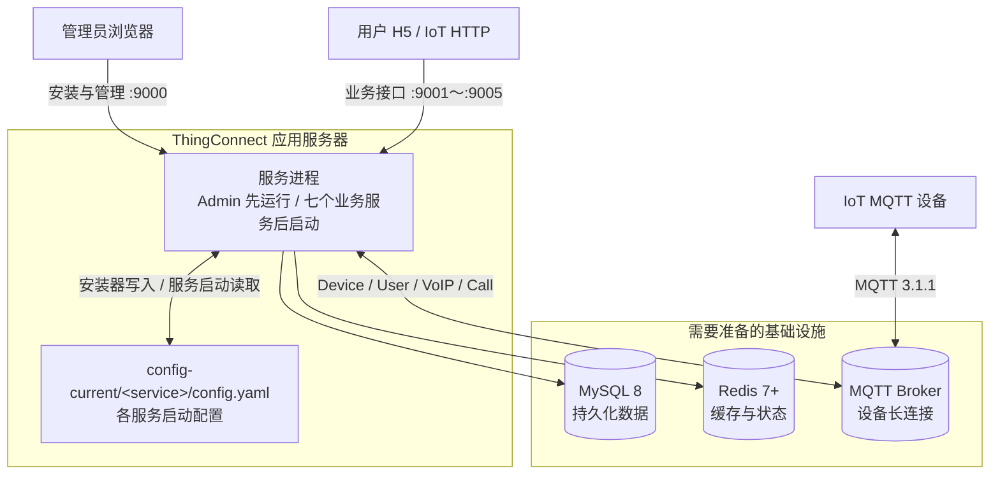

# ThingConnect 安装指南

这份指南适用于 Ubuntu 22.04/24.04，涵盖首次安装、服务验收、业务配置、进程托管、HTTPS、安全收尾和版本更新。默认安装目录为 `/opt/thing-connect`。

从本地工作区部署到 Linux / WSL 做开发联调，见 [本地开发联调部署](deployment-local.md)。

阅读下面的命令时，请先区分几类占位值：

- 浏览器 URL 中的 `127.0.0.1` 指安装服务器本机。从其他电脑访问时，替换为服务器实际 IP。
- 命令中的其他 `127.0.0.1` 表示同机依赖，应按实际部署调整。
- `thing.example.com`、示例账号和密码都要替换。

任何一步失败都应先处理错误，不要跳过检查继续安装。

## 部署顺序

首次部署按下面顺序执行。完成 Web 安装只代表数据库和 Admin 已就绪，业务服务还需要配置和启动。

| 顺序 | 操作 | 完成标志 |
|---|---|---|
| 1 | 按第 2 节准备工具链、MySQL 8、Redis 和数据库账号 | 工具版本正确，数据库与 Redis 连接检查通过 |
| 2 | 按第 3.1 节运行 `install.sh`；Ubuntu 可加 `--install-deps` 准备工具链 | 终端输出安装地址和一次性令牌 |
| 3 | 打开 `http://服务器IP:9000/admin/`，按第 3.2 节检查连接并确认安装 | 安装成功，可以进入 Admin 登录页 |
| 4 | 登录 Admin、绑定 TOTP，发布 `common/tirtc` 和 `user-server/mqtt.connection` | 基础用户服务的必填配置已发布 |
| 5 | 按第 4.2 节启用需要的可选服务，再执行 `service-local.sh start-all` | Admin、Device、User 及选中的可选服务启动成功 |
| 6 | 检查各已启用服务的 `/health/ready`，再完成进程托管、HTTPS 和公网代理 | 健康接口成功，对外入口可访问 |
| 7 | 后续按第 4.6 节执行 `deploy-prod.sh update` | 更新成功；不需要重新运行安装向导 |

如果只需要基础用户服务，第 5 步无需启用任何可选服务。使用 AI、VoIP、Call 或 Recognition 时，先发布该业务的必需配置，再启用。

## 整体架构



| 组件 | 用途 | 安装时要注意什么 |
|---|---|---|
| MySQL | 保存用户、设备、业务数据、动态配置和安装状态 | 迁移账号负责建库、建表和升级；所有服务共用运行账号，生产环境建议使用独立的 DML 账号 |
| Redis | 保存会话、验证码、限频、在线状态和短期协调数据 | Admin 与已启用业务服务连接同一个 Redis 实例和 DB |
| MQTT Broker | 承载设备长连接和实时指令 | Device、User、VoIP、Call、Recognition 分别配置账号；Admin、AI 不直接连接 Broker |
| `config-current/<service>/config.yaml` | 保存进程启动所需的基础配置和共享密钥 | 由安装器生成，不要手工拆分或复制 revision |
| Admin | 首次安装、动态配置和服务状态 | 首次安装只启动 Admin；Admin 不执行主机命令或进程控制 |

MQTT、TiRTC 和普通业务配置通过 Admin 发布并存入 MySQL。业务服务启动时读取阻断配置，运行期间再按注册表中的 reload 策略应用更新。管理员完成必填配置后，需要登录服务器执行页面给出的 `service-local.sh` 命令来启动业务服务。

安装前需要准备 Linux 应用服务器、MySQL 8、Redis 7+，以及首个管理员的邮箱和密码。MQTT、TiRTC、SMTP、人机验证、微信、AI 资源、Nginx 和证书都在 Admin 安装完成后配置。

Nginx、HTTPS 和生产进程托管都不是首次安装页面的前置条件。

## 1. 服务与端口

| 服务 | 默认 HTTP 端口 | 安装要求 |
|---|---:|---|
| `admin-server` | 9000 | 必装，管理后台和配置中心 |
| `device-server` | 9001 | 生成基础配置，完成 MQTT 后由服务器命令启动 |
| `user-server` | 9002 | 生成基础配置，完成 MQTT、TiRTC 后启动，同时提供用户 H5 |
| `voip-server` | 9003 | 生成基础配置，完成 MQTT、TiRTC 后启动 |
| `ai-server` | 9004 | 生成基础配置，完成 TiRTC 后启动 |
| `call-server` | 9005 | 生成基础配置，完成 MQTT、TiRTC 后启动 |
| `recognition-server` | 9006 | 生成基础配置，完成 MQTT 后启动；受理识别任务还需配置千问 Key |

首次安装会构建服务清单中的全部服务，并为 Admin 与七个业务服务生成基础配置。安装结束时只有 Admin 运行；安装器和 Admin 都不会自动启动业务服务。管理员按需完成配置并启用业务服务，`start-all` 只启动启用清单中的服务。

应用端口使用上表默认值。安装页面只填写 MySQL、Redis 及部署访问地址，不在首次安装中任意重排应用端口。业务服务必须在 Admin 就绪且启动前检查通过后启动。

服务清单以 [`internal/installer/service_catalog.tsv`](internal/installer/service_catalog.tsv) 为准。构建脚本、首次安装、本地进程控制、日常发布和安装页面都读取这份清单；安装时，清单和加载器也会发布到部署根目录。

增加业务服务时，需要在清单中登记名称、HTTP 端口、必装或可选、MQTT 依赖、静态资源目录和显示名称，并提供同名 Go 构建入口及可生成、可校验的配置。如果服务还有跨服务配置、动态配置或进程托管要求，也要同步实现对应 adapter、注册表和托管配置，不能只增加一条清单记录。

## 2. 安装前准备

### 2.1 安装构建工具

首次安装只需准备构建工具和外部依赖；反向代理与生产进程托管在安装成功后配置。安装基础工具：

```bash
(
  set -Eeuo pipefail
  sudo apt-get update
  sudo apt-get install -y \
    ca-certificates curl default-mysql-client git \
    redis-tools snapd util-linux
  sudo systemctl enable --now snapd.socket
  sudo snap install go --classic
  sudo snap install node --classic --channel=24/stable
)
```

使用企业软件源或已有工具链时可跳过 `snap install`，但必须满足 Go 1.21+、Node.js 22.12+、npm 10+。验证：

```bash
(
  set -Eeuo pipefail
  go version
  node --version
  npm --version
  GO_VERSION="$(go env GOVERSION)"
  awk -v version="${GO_VERSION#go}" '
    BEGIN {
      split(version, part, ".")
      exit !(part[1] > 1 || (part[1] == 1 && part[2] >= 21))
    }
  ' || {
    echo "Go 版本不满足 1.21+: $GO_VERSION" >&2
    exit 1
  }
  node -e '
    const [major, minor] = process.versions.node.split(".").map(Number);
    if (!((major === 20 && minor >= 19) ||
          (major === 22 && minor >= 12) || major > 22)) {
      console.error(`Node.js 版本不满足要求: ${process.versions.node}`);
      process.exit(1);
    }
  '
  NPM_MAJOR="$(npm --version | cut -d. -f1)"
  [ "$NPM_MAJOR" -ge 10 ] || {
    echo "npm 版本不满足 10+: $(npm --version)" >&2
    exit 1
  }
  command -v \
    cp curl flock git go mv mysql mysqldump \
    node npm redis-cli setsid
)
```

安装服务器需要访问 Git 仓库、Go Module 源和 npm Registry。`install.sh` 会自行拉取源码并在服务器上构建二进制、用户 H5 和 Admin Web。

### 2.2 准备依赖和网络

MySQL 和 Redis 可以部署在同机或独立服务器。上述工具安装命令和 `--install-deps` 只准备工具链及数据库客户端，不安装 MySQL/Redis 服务，也不创建账号；先由运维准备可连接的实例，再继续安装。

准备以下信息：

- MySQL 8.0+ 地址、端口、目标数据库名及迁移、运行账号凭据（允许使用同一账号）。
- Redis 7+ 地址、端口、密码和 DB 编号。
- 应用服务器 IP；生产反向代理还需提前确定最终域名和 HTTPS 方案。
- 首个管理员邮箱和密码。密码至少 8 位，且必须包含英文大写字母、英文小写字母和数字；允许同时使用中文和特殊字符。

首次安装时只需允许管理员来源访问 TCP 9000。完成后按实际启用服务允许受信网络访问 9000～9006。MySQL 和 Redis 不应对公网开放；MQTT 仅在公网设备确需连接时开放启用 TLS、强认证和 Topic ACL 的设备接入端口，Broker 管理端口不得开放公网。

直接暴露业务端口会同时暴露该进程的路由面，只适合可信网络或验收。公网部署应使用第 4 节的 Nginx 单一入口，并禁止代理 `/v1/internal/*` 及各业务服务的 `/internal/*`。

### 2.3 准备 MySQL 账号

安装页面分别填写两组凭据，允许使用同一账号；生产环境建议分开配置：

- 迁移账号：创建目标数据库、建表并执行版本化迁移。
- 运行账号：所有已启用服务共用，需要 DML 权限；生产环境建议只授予 DML 权限。

安装器不创建 MySQL 用户、不执行 `GRANT`，因此迁移账号不需要 `GRANT OPTION`。先以 DBA 账号登录：

```bash
export MYSQL_HOST=127.0.0.1
export MYSQL_PORT=3306
mysql -h "$MYSQL_HOST" -P "$MYSQL_PORT" -u root -p
```

在 MySQL 客户端中执行。先替换两个密码；`thing_connect` 必须与安装页面填写的数据库名一致。生产环境应把 `%` 改成应用服务器来源地址：

```sql
CREATE USER IF NOT EXISTS 'thingconnect_migrator'@'%';
ALTER USER 'thingconnect_migrator'@'%'
  IDENTIFIED BY 'replace-with-migration-password';

CREATE USER IF NOT EXISTS 'thingconnect_runtime'@'%';
ALTER USER 'thingconnect_runtime'@'%'
  IDENTIFIED BY 'replace-with-runtime-password';

GRANT CREATE, ALTER, INDEX, SELECT, INSERT, UPDATE, DELETE
ON thing_connect.* TO 'thingconnect_migrator'@'%';

GRANT SELECT, INSERT, UPDATE, DELETE
ON thing_connect.* TO 'thingconnect_runtime'@'%';

EXIT;
```

首次安装只接受不存在或完全无表的专用数据库。迁移账号的库级 `CREATE` 权限允许安装器创建不存在的库；以下独立账号示例中，运行账号只有 DML 权限。如果数据库必须由 DBA 创建，在授权前执行：

```sql
CREATE DATABASE thing_connect
  CHARACTER SET utf8mb4 COLLATE utf8mb4_0900_ai_ci;
```

验证账号可以登录；此时不需要选择目标数据库：

```bash
(
  set -Eeuo pipefail
  export MYSQL_HOST=127.0.0.1
  export MYSQL_PORT=3306
  mysql -h "$MYSQL_HOST" -P "$MYSQL_PORT" \
    -u thingconnect_migrator -p -e "SELECT CURRENT_USER()"
  mysql -h "$MYSQL_HOST" -P "$MYSQL_PORT" \
    -u thingconnect_runtime -p -e "SELECT CURRENT_USER()"
)
```

> 不要手工导入 `scripts/schema.sql`。
>
> - 首次安装只接受不存在或完全无表的专用数据库。发现已有表时，安装器读取结构后停止，不会建表、迁移、补数据、清空或覆盖。
> - 旧版 ThingConnect 数据库应先完成可恢复备份，再按第 4.6 节升级，不要交给首次安装入口。
> - Web 预检先在不选择目标数据库的情况下验证运行账号登录。表结构就绪后，再用不写入业务数据的零行语句逐表检查 DML 权限。

#### MySQL 连接预算

每个服务进程都有独立连接池。启动 YAML 的 `database.max_open_conns` 默认是 `50`（省略或 `0`），`database.max_idle_conns` 默认是 `10`，且不超过连接上限；显式设置空闲连接为 `0` 表示不保留空闲连接。负数或空闲连接大于连接上限会导致启动失败。修改后重启对应服务；这些参数不在 Admin 动态配置中管理。

按所有服务实例的连接池上限之和计算容量，并为迁移、管理、监控和并发测试预留连接。例如，八个服务各设置 `max_open_conns: 10`、`max_idle_conns: 2`，最多占用 80 个连接；MySQL 上限为 100 时剩余 20 个连接供其他任务使用。该示例适用于小型测试环境，生产参数应结合实例数、并发负载和数据库内存评估。

运维时检查 MySQL 的 `max_connections`、账号连接限制，以及 `Threads_connected`、`Max_used_connections`。出现连接耗尽时同时排查连接池总预算、长事务和连接未释放；不要仅提高数据库上限。

### 2.4 验证 Redis

```bash
(
  set -Eeuo pipefail
  export REDIS_HOST=127.0.0.1
  export REDIS_PORT=6379
  read -srp "Redis 密码（无密码直接回车）: " REDISCLI_AUTH
  echo
  export REDISCLI_AUTH
  redis-cli -h "$REDIS_HOST" -p "$REDIS_PORT" PING
  unset REDISCLI_AUTH
)
```

Redis 保存设备在线状态和待写入 MySQL 的连接记录，选型和配置须满足：

- 使用单一访问地址的单节点或主备高可用实例。阿里云选择 Redis 标准版（双副本 / 高可用），版本 7.0 及以上。
- 不支持集群版和读写分离版：在线状态脚本在同一次执行中读写多个 key，集群版无法跨槽执行；从只读副本读取会读到滞后的在线状态。
- 开启持久化（AOF 或 RDB 加 AOF），主备切换和重启后保留待写记录。
- 内存淘汰策略设为 `noeviction`，并为在线 key 留足内存。被淘汰的在线 key 会让设备显示离线，被淘汰的待写记录会丢失上线 IP。

MQTT 凭据在 Admin 安装完成后配置，Device、User、VoIP、Call、Recognition 各用一套。需要注意以下限制：

- Username 模式会结合进程的 `SERVICE_INSTANCE_ID` 生成实际 ClientID。
- 固定 ClientID 不能由多个服务或副本共用。
- 使用 `mqtts://` 时，应用服务器的系统信任库必须能够验证 Broker 证书链。
- 服务启动前会做一次连接认证检查。检查不订阅消息，也不写 Redis；失败时服务保持停止。

TiRTC App ID、Access Key ID 和 Secret Key ID 同样没有可运行默认值。User、VoIP、AI、Call 在启动前要求该配置已经由 Admin 发布。

## 3. 首次安装

### 3.1 下载并运行安装脚本

以下命令只下载首次安装入口。脚本会把完整仓库克隆到 `/opt/thing-connect/tirtc-server-example`，默认使用仓库的默认分支 `main`，适合开发与集成验证。`main` 包含待发布改动；生产应选择稳定版 tag，并按该版本的发布说明或受控发布流程部署。当前安装脚本没有固定 tag 或自动选择最新稳定版的参数；仅修改脚本下载 URL 不能固定后续克隆的源码版本。

```bash
(
  set -Eeuo pipefail
  curl -fsSLo /tmp/thing-connect-install.sh \
    https://raw.githubusercontent.com/tangeai/tirtc-server-example/main/thing-connect/scripts/install.sh
  bash -n /tmp/thing-connect-install.sh
  chmod 0755 /tmp/thing-connect-install.sh
  sudo env \
    PATH=/usr/local/sbin:/usr/local/bin:/usr/sbin:/usr/bin:/sbin:/bin:/snap/bin \
    /tmp/thing-connect-install.sh
)
```

使用其他工具链目录时，把它显式加入上述受控 `PATH`，不要把未经检查的用户 `PATH` 整体传给 `sudo`。

私有镜像仓库或自定义目录使用环境变量，不要修改脚本：

```bash
sudo env \
  PATH=/usr/local/sbin:/usr/local/bin:/usr/sbin:/usr/bin:/sbin:/bin:/snap/bin \
  REPO_URL=git@example.com:team/tirtc-server-example.git \
  DEPLOY_ROOT=/opt/thing-connect \
  /tmp/thing-connect-install.sh
```

`install.sh` 依次执行：

1. 取得部署锁，检查工具链版本、安装状态和安装端口；未完成安装进入恢复流程。
2. 克隆仓库；已有干净工作树时只允许 `git pull --ff-only`。
3. 按服务清单完整构建所有服务和 Web 静态资源。
4. 发布首次运行所需的二进制、静态资源、服务清单和本地服务脚本。
5. 生成只显示一次的安装令牌，通过本地启动脚本启动 Admin 安装模式。

Ubuntu 使用 `sudo env PATH=/usr/local/sbin:/usr/local/bin:/usr/sbin:/usr/bin:/sbin:/bin:/snap/bin /tmp/thing-connect-install.sh --install-deps` 可安装缺少的基础工具及 Go、Node Snap。已有 Snap 工具链保留；版本不符合要求时按报错升级。MySQL、Redis 和第三方账号仍需提前准备。

安装中断后，使用相同 `DEPLOY_ROOT` 再次执行安装入口。已有安装状态时复用已发布文件；尚未提交配置时停止旧安装进程、生成新令牌并恢复页面，旧令牌失效。配置已经提交时启动 Admin 完成恢复；安装完成时提示使用更新入口。恢复文件不完整时保留现场并报出缺失项，不删除配置或数据库。

脚本不配置反向代理、HTTPS、开机自启或日志轮转，也不复制示例配置。

### 3.2 完成 Web 安装

在安装服务器本机的浏览器打开：

```text
http://127.0.0.1:9000/admin/
```

从其他电脑访问时，把 `127.0.0.1` 替换为安装服务器实际可达的局域网或公网 IP。

安装端口默认监听所有网卡，所有写操作都要求终端输出的一次性令牌。安装完成前，仍应通过安全组或防火墙把 9000 限制到管理员来源。不要把令牌发送到聊天、工单或监控系统。

安装页面依次填写：

1. MySQL 主机、端口、专用数据库名、迁移账号和 DML 运行账号。
2. Redis 主机、端口、密码和 DB。
3. 首个管理员账号。
4. 统一对外访问地址、可信代理和 HTTPS Cookie。生产环境即使稍后才配置 Nginx，也应填写最终的 `https://` 地址并勾选 HTTPS Cookie；只做本机或可信内网直连验收时可以留空并关闭 HTTPS Cookie。同机 Nginx 使用默认可信代理 `127.0.0.1`。

页面不要求 MQTT、TiRTC 或业务服务选择。安装器始终生成七个业务服务的基础配置，但只启动 Admin。

先执行“连接检查并生成安装计划”，核对数据库动作，再确认安装：

| 数据库状态 | 安装器行为 |
|---|---|
| 不存在 | 创建数据库并初始化表 |
| 已存在且无表 | 初始化表 |
| 本机同一操作标识的中断任务 | 只恢复该未完成任务，不接管其他数据库 |
| 其他任何已有表的数据库 | 只读识别后拒绝，不建表、迁移、补数据、清空或覆盖 |

预检或安装失败时，页面会保留失败阶段、具体依赖和处理建议，无需打开浏览器开发者工具。修复地址、账号授权或 TLS 后再重试。服务端日志记录脱敏后的详细原因，页面不会显示密码、内网连接串或上游客户端原始错误。

安装器会生成以下密钥，并以 `0600` 权限写入带摘要校验的一次性配置 revision：

- 业务服务共享的 JWT 密钥
- 已安装服务共享的 `internal.key`
- Admin JWT 密钥
- MFA 加密密钥

数据库提交和配置激活都有恢复记录。安装中断后，应使用同一部署目录和数据库继续，不要删除表，也不要手工改写 `config-current`。

令牌丢失且尚未提交配置时，可重新运行：

```bash
sudo env \
  PATH=/usr/local/sbin:/usr/local/bin:/usr/sbin:/usr/bin:/sbin:/bin:/snap/bin \
  /opt/thing-connect/install.sh
```

配置已经激活但安装未结束时，重启 Admin 会自动完成本机同一安装任务的对账，但不会拉起业务服务。返回安装页面，输入一次性令牌并完成 Admin 安装。不要删表、删配置或重新安装。

## 4. 安装后必须完成

### 4.1 在 Admin 发布启动必需配置

首次登录 Admin Web 时绑定 TOTP，并把恢复码离线保存。然后在配置中心发布：

| 服务 | 启动前需发布的配置 |
|---|---|
| Device（必需） | 发布独立 MQTT 连接，用于维护设备在线状态 |
| User（必需） | `common/tirtc`、`user-server/mqtt.connection` |
| AI（按需启用） | `common/tirtc`；角色和资源按业务需要配置 |
| VoIP（按需启用） | `common/tirtc`、`voip-server/mqtt.connection`；使用微信通话还需配置微信应用 |
| Call（按需启用） | `common/tirtc`、`call-server/mqtt.connection` |
| Recognition（按需启用） | `recognition-server/mqtt.connection`；使用模型能力还需配置模型 Key |

各 MQTT 服务使用独立账号或 ClientID。未使用的可选业务无需为了启动基础服务而填写配置。

MQTT 配置表单提供“测试连接”和“测试并发布”两个操作：

- “测试连接”使用尚未发布的表单值，从 Admin 服务器检查 Broker 网络、TLS 和账号认证。
- “测试并发布”先执行同样的检查，成功后才写入数据库。
- 固定 ClientID 模式使用临时连接 ID 测试，避免挤掉正在运行的同名客户端。

检查失败时，页面会提示 Broker 可达性、证书、凭据或来源授权问题。业务服务启动预检仍会使用正式 ClientID 做最终确认。

Admin 的服务状态页显示每个服务缺少的配置及原因；配置齐全时显示可复制的服务器启动或重启命令。Admin 只提供状态和指引，不执行主机进程命令。

普通运行时配置发布后会热加载。MQTT 和 TiRTC 在页面中标记为“需重启”，发布后应执行页面给出的重启命令。

TiRTC 配置只检查字段完整性和格式，业务服务启动预检会再确认配置可以读取。目前没有一种既能证明凭据有效、又不会产生业务副作用的通用在线测试。SMTP、人机验证、微信应用和 AI 资源按实际需要发布。

动态配置没有数据库记录时，使用后端注册表默认值；MQTT 和 TiRTC 没有可运行默认值，必须显式发布。

普通配置和密钥以明文 JSON 存储在 MySQL。Admin Web 默认用 `*` 遮盖密钥，具备权限的管理员可以查看原值，因此必须限制数据库和备份的访问范围，并启用审计。

### 用户页面语言

海外独立站在 Admin 的用户服务、AI 服务和呼叫服务配置页分别将 `web.language` 的默认语言设为 English。允许用户切换时，同一站点内沿用浏览器记住的手动选择；禁止切换时，按当前服务的默认语言展示。配置发布后在下次打开页面时生效，实例应用版本可在服务状态页查看。

未发布后台语言配置时，各服务使用自身 YAML 的 `web.language.default` 和 `web.language.allow_switch`；省略时为 `auto` 和 `true`。语言配置不改变启动时对 Admin 的依赖。英文页面翻译界面和操作提示；邮件模板、AI 对话语言以及云端资源描述需要单独配置。

官网上线时，在 Admin 的用户服务配置中设置 `web.site.public_url` 为正式 HTTPS 根地址，并填写站点名称。反向代理将 `/`、`/boards`、`/boards/<detail_slug>`、`/getting-started`、`/faq`、`/guides/simulator`、`/guides/wechat-voip`、`/guides/linux-device`、`/robots.txt`、`/sitemap.xml` 交给 user-server，避免以静态 `index.html` 替代服务端页面。首页 HTML 包含核心能力、体验步骤和前三块已上架开发板；开发板页包含无脚本目录，独立详情页使用后台配置的详情标识作为地址，展示已上架型号的适配状态和接入资源。接入指南与常见问题可在无 JavaScript 环境阅读；常见问题的结构化数据与页面答案一致。站点地图包含公开内容页和已上架开发板；下架详情返回 404，目录依赖暂时不可用时站点地图返回 503 并提示稍后重试。标题、描述、Open Graph 和 JSON-LD 随站名配置生成；正式网址用于 canonical 和站点地图，避免使用请求 Host 推断网址。未配置网址时 `/sitemap.xml` 返回 404。登录及设备等用户页面发送 `X-Robots-Tag: noindex, nofollow`。搜索收录和 AI 引用由相应平台决定。

上线验收时，直接获取上述地址的 HTML，确认正文、canonical 正式域名与 JSON-LD 无需运行 JavaScript 即可读取；检查站点地图中的每个地址返回 200，已下架型号返回 404。使用手机和桌面浏览器验证接入指南、常见问题及开发板详情入口，保留原有 `/boards#<detail_slug>` 弹窗链接的可用性。在搜索平台站长工具中提交正式站点地图并检查收录；抓取、索引与 AI 引用结果需通过平台数据持续观察，不能仅凭页面标签判断。

#### 公开页面验收与效果观察

部署后从仓库的 `thing-connect/` 目录运行只读验收：

```bash
python3 scripts/check-public-site.py --base-url https://你的正式域名 --json-output /tmp/public-site-check.json
```

脚本检查 robots、站点地图、所有地图地址的 HTTP 状态、canonical、标题与描述、原始 HTML 正文、JSON-LD、分享元数据，以及登录和设备页面的 noindex。失败时返回非零退出码；可以接入部署后的验收任务。响应时间和字节数仅用于定位单次请求，不代表 Core Web Vitals 或搜索排名。

- `/robots.txt` 返回 404：当前代码始终提供该路由，应检查正在运行的 user-server 版本、反向代理和 CDN 规则。
- `/sitemap.xml` 返回 404、页面缺少 canonical：检查公开接口 `/v1/config/site` 的 `public_url`，再到 Admin 配置 `web.site.public_url`。不要使用请求 Host 或猜测的域名生成正式地址。
- 站点地图返回 503：先恢复目录依赖，再重新验收；不要把临时失败的空目录当作已下架内容。
- `/guides/*` 返回 404：检查已部署版本和根路径到 user-server 的转发。三个教程使用服务端 HTML，页面内容、来源链接和命令无需 JavaScript 即可读取。教程目前提供简体中文内容。

开发板详情的“资料更新”与站点地图 lastmod 使用目录记录的真实更新时间，不能作为固件发布日期或实机验证日期。版本、已知限制和测试结论应在对应的固件说明、源码或烧录指南中记录，并标明型号、版本、环境、步骤和结果；没有测试证据时不填写延迟、稳定性或量产结论。

完成 HTTP 验收后，在有权限的 Google Search Console、Bing Webmaster Tools 等站长工具中验证域名并提交 `/sitemap.xml`。分别观察收录页面、非品牌查询的曝光与点击，以及平台提供的 AI 引用报告；某个平台的引用数据不代表其他平台。站点未接入第三方访问统计时，不能从页面代码推断访问量或用户转化。

需要评估内容价值时，可在选定的统计系统中关联教程访问、固件下载、开始体验与设备绑定成功等事件。下载点击与绑定成功应分别统计；报表只保留所需的汇总信息，不采集验证码、设备凭证、token 或原始请求体。先建立数据基线，再决定英文独立内容、更多教程或性能专项的投入范围。

### 4.2 在服务器预检并启动业务服务

首次安装的 `/opt/thing-connect/enabled-services` 只启用 Admin、Device、User。VoIP、AI、Call、Recognition 的配置文件可以存在，但需要先在 Admin 发布该业务的必需配置，再显式启用。例如启用 AI：

```bash
sudo /opt/thing-connect/service-local.sh enable ai-server
sudo /opt/thing-connect/service-local.sh start-all
curl -fsS http://127.0.0.1:9004/health/ready
```

`disable ai-server` 保存停用状态并停止服务；必需服务不能停用。没有启用清单的旧安装保留按已有配置启动的行为。`enable` / `disable` 适用于本地进程管理；Supervisor 部署还需同步其进程定义，避免两个管理器混用。


需要的配置发布后，在安装服务器执行：

```bash
sudo /opt/thing-connect/service-local.sh start-all
```

`start-all` 先确认 Admin readiness，再依次检查已启用业务服务：

- 基础 YAML 和 Admin 启动阻断配置
- MySQL 连接及 schema 版本
- Redis 连接
- 对应服务的 MQTT 账号认证

首次启动的预检失败时，待启动业务服务保持停止，终端会显示原因和处理建议。预检不会执行数据库迁移，也不会修改业务数据。

逐个启动可用于排查。`start` 本身不保存启用状态；可选服务先执行 `enable`，后续 `start-all` 和更新才会管理它：

```bash
sudo /opt/thing-connect/service-local.sh start thing-connect:device-server
sudo /opt/thing-connect/service-local.sh start thing-connect:user-server
# 例如需要多人对讲时，先完成 Call 配置，再启用和启动：
sudo /opt/thing-connect/service-local.sh enable call-server
sudo /opt/thing-connect/service-local.sh start thing-connect:call-server
```

启动完成后检查进程和已启用服务的直接端口：

```bash
(
  set -Eeuo pipefail
  sudo /opt/thing-connect/service-local.sh status-all
  curl -fsS http://127.0.0.1:9000/health/ready
  curl -fsS http://127.0.0.1:9001/health/ready
  curl -fsS http://127.0.0.1:9002/health/ready
)
```

安装服务器本机的直接入口：

- Admin Web：`http://127.0.0.1:9000/admin/`
- 用户 H5：`http://127.0.0.1:9002/`
- Device API 基础地址：`http://127.0.0.1:9001/v1/device`，验收时调用 API Reference 中的具体接口。
- VoIP、AI、Call API：分别使用 9003、9004、9005。

从其他电脑验收时，把上述 `127.0.0.1` 替换为服务器实际 IP。

`/health/live` 只表示进程存活；`/health/ready` 才表示必需依赖和数据库版本满足要求。

安装器使用的本地服务脚本可用于首次验收、故障排查，以及未接入独立进程管理器时的本机运行：

```bash
sudo /opt/thing-connect/service-local.sh status-all
sudo /opt/thing-connect/service-local.sh start-all
sudo /opt/thing-connect/service-local.sh stop-all
sudo /opt/thing-connect/service-local.sh restart thing-connect:admin-server
```


该脚本不注册开机服务，也不提供日志轮转。长期运行时，运维环境需要另外负责开机启动、日志收集和轮转；具体做法见 4.3 节。

本地服务脚本可能显示以下状态：

| 状态 | 含义与处理 |
|---|---|
| `RUNNING` | 服务已通过进程存活检查 |
| `STARTING` | 守护脚本存在，但服务尚未开始监听 |
| `CONFLICT` | 检测到历史遗留的多个守护进程；先执行对应服务的 `stop`，再检查端口和日志 |

同一服务的守护进程使用独占锁。PID 文件丢失时，脚本会扫描并接管原守护进程，不会再启动一份。

### 4.3 可选：接入生产进程托管

不要求安装 Supervisor。可以继续用 `service-local.sh` 管理服务并由更新脚本自动停启及验收；需要开机自启、集中日志时，再接入 systemd、Supervisor、容器平台或其他现有编排系统。托管配置必须满足以下约束：

- 切换前执行 `sudo /opt/thing-connect/service-local.sh stop-all`，确认本地脚本管理的进程已停止，再启动新的进程管理器。
- Admin 先启动并达到 `/health/ready`，再预检并启动已启用的业务服务。
- 每个进程使用安装器生成的对应 `config-current/<service>/config.yaml`，不要复制或手工拆分配置 revision。
- 每个进程设置稳定且唯一的 `SERVICE_INSTANCE_ID`；Username MQTT 模式依赖它生成不冲突的连接 ClientID。
- 除 Admin 外，业务服务可以运行多个实例，条件和配置见[业务服务多实例](#multi-instance)。
- 向进程发送 `SIGTERM` 并留出优雅退出时间，不使用强制终止作为正常重启方式。
- 优雅退出时间不得短于后台投递的收尾时间：User 至少 50 秒，Recognition 至少 100 秒（Supervisor 的 `stopwaitsecs`，取值见 [Supervisor 模板](deploy/supervisor/thing-connect.supervisor.conf)）。沿用旧模板的 Supervisor 配置须同步这两项，否则超时后进程被强制终止，未完成的后台投递会被中断。
- 对全部业务服务执行 readiness 检查；`/health/live` 不能替代 `/health/ready`。
- 部署环境负责异常重启、开机自启、日志收集和日志轮转，且同一服务同一实例不能同时被两个进程管理器拉起。
- 安装产物默认归 `root` 所有。改用非 `root` 运行账号时，只调整该账号必需的配置读取、日志和任务目录权限，并继续保护 `0600` 配置中的数据库与服务密钥。

<a id="multi-instance"></a>

#### 业务服务多实例

Device、User、VoIP、AI、Call 和 Recognition 可以各自运行多个实例分担请求并互为备份；Admin 只运行一个实例。`service-local.sh` 支持本机多实例，配置步骤见[本机多实例联调](deployment-local.md#本机多实例联调)；生产也可使用 Supervisor 或其他进程管理器。启用前须满足：

- 连接 MQTT 的服务（AI 以外）在 Admin 中把 `<服务>/mqtt.connection` 设为 Username 认证方式。ClientID 认证方式使用固定 ClientID，多个实例会互相挤掉连接，只能单实例运行。
- 每个实例的 `SERVICE_INSTANCE_ID` 和 HTTP 端口不能重复。MQTT ClientID 由 Username 和实例 ID 组成，两个进程使用同一实例 ID 时，后连接的进程会挤掉前一个。服务状态通过心跳发现同一 ID 的另一个运行中进程，把该实例的 `instance_id` 依赖标为 `unhealthy` 并写入错误日志；两个进程都会降级，为其中一个改用唯一 ID 并重启后恢复。该检查要求各主机时钟同步，且不摘除 HTTP readiness。同一服务的实例共用一个 `config.yaml`，用环境变量 `THING_CONNECT_HTTP_PORT` 覆盖 `server.http_port`。
- 按全部实例重新核算 [MySQL 连接预算](#mysql-连接预算)：每个实例都有独立连接池，总量为各服务“实例数 × `max_open_conns`”之和。Redis 同样按实例数估算客户端连接。
- 公网请求经 Nginx 分发，每个服务的 upstream 列出全部实例。
- 运行多个 AI、VoIP 或 Call 实例时，User 调用它们内部接口的地址也要负载均衡：启用 Nginx 模板中注释掉的内网入口（只监听 `127.0.0.1:9100`，只转发 `/v1/{ai,voip,call}/internal/`），并把 User 启动配置（`config-current/user-server/config.yaml`）中的 `ai.server_url`、`voip.server_url`、`call.server_url` 改为 `http://127.0.0.1:9100`，然后重启 User。内网入口不得开放到公网，`internal.key` 不变。
- 实例分布在多台机器时，所有机器须启用 NTP 时钟同步；Admin 上传的开发板图片保存在 Admin 部署根目录的 `var/board-images`，由 User 从本机读取，须把该目录挂载为共享存储，或只在与 Admin 同机的 User 实例上提供 `/v1/board-images/`。同机多实例只分担进程故障，不等于高可用。

[Supervisor 模板](deploy/supervisor/thing-connect.supervisor.conf)中注释掉的 `device-server-2` 和 `user-server-2` 是第二个实例的写法，约定端口为主实例端口加 10（Device 9011、User 9012、VoIP 9013、AI 9014、Call 9015、Recognition 9016）。取消注释并修改程序名、目录、实例 ID 和端口，保留原程序的 `priority`，把新程序加入 `[group:thing-connect]` 的 `programs`，执行 `sudo supervisorctl reread && sudo supervisorctl update`。再在 [Nginx 模板](deploy/nginx/thing-connect.nginx.conf)对应 upstream 中加入 `server 127.0.0.1:<端口> max_fails=0;` 并重新加载 Nginx。已停止的实例拒绝连接时，Nginx 把请求转给下一个实例。每个 `server` 都须保留 `max_fails=0`：Nginx 默认在一次连接失败后把该实例排除 10 秒，刚重启完的实例仍被排除时再重启下一台，upstream 没有可用实例，请求返回 502。

`deploy-prod.sh` 把 Supervisor 组中名为 `<服务>-<数字>` 的程序识别为该服务的额外实例，在启动或重启业务服务前预检必填配置和依赖，多实例服务再按清单数量预检 MQTT 配置，按进程环境中的 `THING_CONNECT_HTTP_PORT` 检查各自的 `/health/ready`。`restart` 逐台重启：上一台通过 readiness 后才重启下一台，其余实例继续服务。`update` 仍先停止全部服务再迁移和发布，避免新旧二进制在同一数据库结构上混跑。

User 实例收到停止信号后先排空 HTTP，再等正在投递的邮件和队列确认完成。Supervisor 和本地控制器为每个 User 实例预留 50 秒退出时间。

VoIP 使用微信稳定版接口凭据。微信拒绝缓存的 token 时，实例先读取微信当前凭据；若仍是被拒的值，通过 Redis 键 `voip:wechat:refresh:<appid>`（TTL 30 秒，不保存 token）协调同一 AppID 的强制刷新，所有实例合计每 30 秒最多一次；被拒的 token 在本实例 2 小时内不再使用。刷新失败期间，各实例按 1～5 秒退避重新读取微信当前凭据，期间相关接口返回微信接口调用失败，取得新 token 后自动恢复。业务调用最多重试一次。重置 AppSecret 后，应先在 Admin 发布新的密钥。

验收时在 Broker 客户端列表确认每个实例各有一个连接且保持在线，ClientID 互不相同；逐个重启实例期间，经 Nginx 的请求不出现 502 或连接失败。

### 4.4 可选：配置 Nginx 单一入口

直接端口已经可以使用，Nginx 不是首次安装条件。需要域名、统一 80 端口或公网隔离内部路由时再安装：

```bash
(
  set -Eeuo pipefail
  export THING_DOMAIN=thing.example.com
  [ "$THING_DOMAIN" != "thing.example.com" ] || {
    echo "请先替换 THING_DOMAIN" >&2
    exit 1
  }
  sudo apt-get update
  sudo apt-get install -y nginx
  cd /opt/thing-connect/tirtc-server-example/thing-connect
  sudo install -m 0644 deploy/nginx/thing-connect.nginx.conf \
    /etc/nginx/conf.d/thing-connect.conf
  sudo sed -i "s/thing\.example\.com/$THING_DOMAIN/g" \
    /etc/nginx/conf.d/thing-connect.conf
  sudo nginx -t
  sudo systemctl enable --now nginx
  sudo systemctl reload nginx
)
```

[Nginx 模板](deploy/nginx/thing-connect.nginx.conf)使用一套公网入口分发请求：

| 路径 | 去向 |
|---|---|
| `/admin/`、`/v1/admin/` | Admin |
| 各业务 API | 对应业务服务 |
| 其他路径 | User H5 |
| 所有内部接口 | 明确拒绝，不向公网代理 |

用户控制台使用 React、TypeScript 和 Vite，源码位于 `user-server/user-web`，构建产物位于 `user-server/static/app`，由 user-server 提供。登录、设备、联系人、角色、多人对讲和实时查看使用同一个应用入口；首页和开发板目录由 user-server 服务端渲染，协议政策为静态内容页。AI、通话等业务服务提供 API，用户页面使用同源 `/v1/*` 地址调用；Admin Web 保持独立的管理入口和权限体系。

`./build.sh user-server` 包含用户前端构建。单独开发前端可执行 `npm --prefix user-server/user-web ci`、`npm --prefix user-server/user-web run dev`，浏览器打开 `http://localhost:5174/login`。Vite 开发代理连接本机默认业务端口，生产环境使用上述 Nginx 分发；不能只启动 user-server 就访问其他服务的业务 API。

角色页入口为 `/agent?device_id=...`，多人对讲入口为 `/room?device_id=...`。旧入口 `/v1/ai/agent` 与 `/v1/call/group/page` 保留同源跳转，查询参数及浏览器片段继续传递。小程序内嵌页与浏览器页面使用相同入口；设备端 API 和 MQTT 协议不依赖页面构建产物。

模板属于运维配置，`install.sh` 不会把它写入系统。Nginx 与服务同机时，安装页面中的 `trusted_proxies` 使用默认值 `127.0.0.1`，不要填写 `0.0.0.0/0`。

模板只监听 80，不申请或管理证书。已有证书时自行增加 443、证书路径和 HTTP 跳转，再执行 `sudo nginx -t && sudo systemctl reload nginx`。安装页面填写的统一对外访问地址和 HTTPS Cookie 必须与最终入口一致，不能只改 Nginx。

HTTP 会明文传输管理员登录信息和会话 Cookie。公网生产环境应在 Nginx 或上游负载均衡器启用 HTTPS。

### 4.5 完成安全与运维收尾

正式开放服务前逐项确认：

- 公网只开放反向代理入口和确有需要的 MQTT TLS 设备接入端口；MySQL、Redis、Broker 管理端口、应用服务直连端口和各服务内部接口不直接暴露公网。
- 公网入口启用 HTTPS，Admin 配置中的 `cookie_secure` 与实际协议一致。
- 安装期间使用过的临时令牌、高权限数据库凭据和初始密码不进入聊天、工单、Shell 历史或监控；发生暴露时立即轮换。
- `config-releases`、`config-current`、`var/installer`、Admin 任务目录和数据库备份只允许受信运维账号读取。
- 为 MySQL 数据、激活配置和安装状态建立定期备份，并在隔离环境验证恢复；配置备份包含明文密钥，必须加密和限制访问。
- 监控全部服务的 `/health/ready`、进程重启次数、磁盘空间、MySQL/Redis/MQTT 可用性，并配置日志收集和轮转。
- 使用非管理员账号完成一次用户注册、设备接入和已启用业务能力的端到端验收，不能只以进程存活作为安装完成标准。

完成以上检查后，首次安装流程结束。

### 4.6 版本更新与数据库升级

`build.sh` 为同一批服务注入统一的程序版本。通过 `BUILD_VERSION=v1.2.3 ./build.sh` 可指定发布版本号；未指定时使用 `git describe --tags --dirty`：干净工作区且当前提交恰好对应标签时为标签本身（如 `v1.0.0`），标签之后的开发构建为“最近标签-提交数-g提交号”（如 `v1.1.0-beta.1-3-g946320b`），有未提交修改时追加 `-dirty`；仓库没有任何标签时使用精确到秒的 UTC 构建时间，后台将其转换为浏览器本地时间展示。`deploy-local.sh` 按本地源码仓库计算版本号和提交号。从有未提交修改的工作区完成的构建，其完整构建标记带有 `-dirty` 后缀，`deploy-prod.sh` 和安装入口拒绝发布；还原修改后需重新构建。后台同时显示 Git 提交号用于排查。构建时间不是服务启动时间；旧程序只有提交号时显示“历史构建（未记录时间）”，重新构建并部署后才会带上时间。配置修订号 `rN` 独立表示动态配置的发布次数，不作为程序版本。


两个脚本用途不同：

| 脚本 | 使用场景 |
|---|---|
| `install.sh` | 开发者首次安装 ThingConnect |
| `deploy-prod.sh` | ThingConnect 维护者在约定的生产目录、服务清单和进程管理方式下持续发布 |

其他部署环境可以参考 `deploy-prod.sh` 的构建、迁移和发布流程，但要按自身目录、权限和服务管理方式调整，不要把它当作通用安装器。

`update` 快进拉取部署仓库当前分支所跟踪的上游，不自动选择稳定版 tag。当前分支为 `main` 时会部署主干最新提交，其中可能包含尚未发布的改动。生产使用前应由维护者明确控制待发布的源码提交与验证结果。切换到 tag 的 detached HEAD 后直接执行 `update` 不属于该脚本支持的固定版本发布方式。

在符合该生产目录约定、且已确认待发布源码的环境中执行维护发布：

```bash
sudo /opt/thing-connect/deploy-prod.sh update
```

完整发布成功后，脚本会在部署根目录原子记录 Git commit 和已安装服务集合。再次更新时先快进拉取源码，再按下面的条件决定是否继续：

| 当前状态 | 处理方式 |
|---|---|
| commit 和服务集合都没变化，且所有服务已有配置 | 输出“当前已发布版本与待发布版本一致”，直接结束 |
| 首次使用发布工具，或发布状态缺失、损坏 | 执行完整更新 |
| 已安装服务集合发生变化 | 执行完整更新 |
| 辅助发布文件没有完整刷新 | 执行完整更新 |

直接结束时，脚本不会检查 Supervisor 或停服状态，也不会安装依赖、构建、备份、检查数据库或重启服务。脚本不根据目录时间或运行中的进程猜测发布版本。

需要在同一 commit 下重新构建或修复发布文件时显式执行：

```bash
sudo env FORCE_UPDATE=1 /opt/thing-connect/deploy-prod.sh update
```

进入完整更新后，脚本先构建新版本，为已启用服务创建部署目录。缺少 `config.yaml` 时复制该服务的 `config.yaml.example`，权限设为 600；已有独立配置或激活配置包保持不变。模板仍含必填占位值时，校验会停止发布，请填写实际生产配置后重新执行 `update`；此时不会替换运行中的程序或执行数据库迁移。相同 commit 下缺少服务配置也会执行此补齐流程。高级 `build` 命令同样在完整构建成功后准备目录和缺失配置。

联系人备注与角色关联保护依赖当前完整 schema：`voip_device_auth.device_remark`、`voip_remark_outbox`、`ai_user_role.deleting` 和 `ai_cloud_role_ref`。部署应按完整更新流程迁移并统一更新服务，不能仅替换联系人页面或单个服务。运行账号需要这些新表的 DML 权限。设备 HTTP/MQTT 协议保持兼容，无需同时升级设备固件。旧共享备注保留在数据库中，但不迁移、不作为展示回退；独立备注未设置时为空。

配置有效后，脚本重新检查服务托管清单，再检查数据库所有权、完整结构和待迁移版本。检查过程只读，优先使用显式 `MIGRATION_CONFIG` 或已有 `admin-server/migration-config.yaml`；未配置独立迁移账号时使用 Admin 当前运行配置。数据库已经是当前版本时，脚本输出“数据库已是当前版本”，跳过数据库备份门槛和 DDL，代码与静态资源仍会继续发布。停服前还会使用新版本 Admin 程序检查已启用业务的必填动态配置和 MySQL、Redis、MQTT 连接，失败时保留原进程。存在待执行迁移时，依赖预检在迁移后、业务启动前执行。

需要迁移时，准备独立配置文件。首次使用可以从当前 Admin 配置复制，保留主机、端口、数据库名及其他字段，只把 `database.dsn` 中的用户名和密码改为第 2.3 节准备的迁移账号：

```bash
# 仅在 migration-config.yaml 尚不存在时复制，避免覆盖已有迁移凭据。
sudo test -e /opt/thing-connect/admin-server/migration-config.yaml || \
  sudo install -m 600 /opt/thing-connect/config-current/admin-server/config.yaml \
    /opt/thing-connect/admin-server/migration-config.yaml
sudoedit /opt/thing-connect/admin-server/migration-config.yaml
sudo chmod 600 /opt/thing-connect/admin-server/migration-config.yaml
```

手动部署未使用 `config-current` 时，从实际使用的 Admin `config.yaml` 复制。不要修改业务服务的运行账号，也不要把迁移配置指向其他数据库。安装页面填写的迁移密码不会自动保存成这个文件。

存在待执行迁移时，脚本在停服前要求具备 DDL 权限的独立 `MIGRATION_CONFIG` 和可恢复的数据库备份。使用 `mysqldump` 生成完整备份，在隔离 MySQL 实例完成恢复演练，再把绝对路径和恢复验证声明传给更新命令。使用 `--databases` 生成的备份含 `CREATE DATABASE` 和 `USE`，在生产实例上导入会直接覆盖生产库；恢复演练必须在隔离实例上进行，或先改写这两行的库名：

```bash
sudo env \
  MIGRATION_CONFIG=/opt/thing-connect/admin-server/migration-config.yaml \
  DATABASE_BACKUP_FILE=/secure/backups/thing-connect-before-update.sql \
  DATABASE_BACKUP_RESTORE_VERIFIED=1 \
  /opt/thing-connect/deploy-prod.sh update
```

存在待执行迁移时，脚本会确认备份文件存在、非空且可读，并记录 SHA-256。缺少备份或未声明恢复验证时，脚本会在执行任何 DDL 前停止；只读迁移检查失败也会停止发布。

`SKIP_MIGRATIONS=1` 只适用于 DBA 已通过独立受控流程完成同一版本迁移的环境，不能用来绕过备份。

该命令取得部署锁后快进拉取源码，重新加载新版本服务清单，构建全部服务，备份当前文件，并按嵌入迁移目录执行缺失数据库版本。迁移版本从 `core/NNN_*.sql` 和 `admin/NNN_*.sql` 自动发现；增加表或修改表时不需要改安装脚本中的版本号。数据库迁移不能随旧二进制自动回滚。

`deploy-prod.sh` 会自动识别服务管理方式：

| 环境 | 发布方式 |
|---|---|
| Supervisor 中包含全部已启用服务 | 预检完成后停止服务，迁移、发布，再按 Admin 优先顺序启动并检查 readiness |
| 没有 `supervisorctl`，或没有任何 ThingConnect 条目 | 使用 `service-local.sh` 自动完成相同停启和验收流程 |

普通更新只需执行 `deploy-prod.sh update`。构建、基础配置校验和依赖连接预检失败时保留运行中的服务；停服后的发布失败触发文件恢复。数据库结构已经变化时，失败会保持整个服务组停止，需人工恢复数据库或确认兼容性，不能直接启动旧版本。

`SERVICE_MANAGER=local` 和 `SERVICE_MANAGER=supervisor` 可明确指定管理器。Supervisor 只配置部分已启用服务时拒绝发布。使用 systemd、容器等外部编排时可显式选择 `SERVICE_MANAGER=manual`，自行完成 stop-all、更新、start-all 和健康检查；该模式要求服务事先停止，并且没有冲突的 Supervisor 条目。

新版本增加服务时，需要同时更新：

- 服务清单
- 可生成、可校验的基础配置
- Admin 动态配置注册表
- 服务器预检
- 进程托管和 readiness

表结构变化还要增加有序、可重入的迁移，并更新 `scripts/schema.sql`。

Supervisor 部署在发布前执行 `supervisorctl reread` 和 `supervisorctl update`。缺少任何已启用服务的进程定义时，发布会在修改文件和数据库前停止。使用手动模式、systemd、容器平台或其他编排系统时，也要提供等价的显式迁移、Admin 优先启动和 readiness 门槛。

### 升级遇到新增必填配置

当新版增加了旧 Admin 无法编辑的必填配置时，`update` 会提供配置阶段，退出码为 `78`，不记录完整发布成功：

- 数据库结构已是目标版本时，只更新并启动新版 Admin，现有业务服务保持运行。
- 数据库需要迁移时，先按正常发布流程停服、迁移和替换文件，再启动新版 Admin；业务配置未完成时，业务服务保持停止。
- 登录新版 Admin，填写、测试并发布提示的配置，再执行同一条 `update` 命令完成发布。不要将 MQTT 连接的 ClientID 与仍运行的其他服务重复使用。
- Admin 发布或就绪检查失败时执行对应回滚流程；数据库结构已变化时不自动恢复旧二进制。手动服务管理模式需由运维启动已更新的 Admin。
- 回滚恢复旧版本时直接启动各实例，跳过启动前的配置与依赖预检；失败原因是依赖故障时，旧版本仍能恢复运行，随后由 readiness 判定是否可用。

配置阶段不绕过业务服务的必填配置和依赖检查，也不会直接复制其他服务的 MQTT 身份。`deploy-local.sh update` 使用相同流程；若部署入口来自旧版本，应确保它打包的本地源码包含此发布流程。

### 4.7 失败后从哪里继续

| 停止位置 | 处理后继续执行 |
|---|---|
| 工具缺失、版本过低或构建失败 | 修复工具链或下载网络，重跑同一个安装/更新命令；构建日志按终端给出的路径查看 |
| 安装页面尚未完成、令牌丢失 | 使用同一目录再次执行 `install.sh`，按第 3.2 节恢复，不删表或配置 |
| 必填配置缺失（退出码 78） | 登录配置阶段提供的新版 Admin，补齐、测试并发布，再重跑 `update`；首次安装按安装流程启动 |
| MQTT 认证或依赖连接预检失败 | 检查连接地址、账号及网络，修复后重跑 `update` |
| 提示需要数据库迁移 | 准备独立迁移配置及可恢复备份，使用第 4.6 节带参数的命令重试 |
| 数据库结构已变化后发布失败 | 保持服务停止，先恢复数据库备份或确认版本兼容性，再处理文件回滚；不能直接启动旧二进制 |
| 服务启动或 readiness 失败 | 查看 `/opt/thing-connect/logs/<服务名>.err.log` 和 `.out.log`，按错误修复；不要只凭 `RUNNING` 判断就绪 |

## 5. 相关文档

Admin 功能、RBAC、配置中心和任务说明见 [Admin Server README](admin/admin-server/README.md)。业务接口见 [API Reference](api-reference.md)，设备接入流程见 [设备接入指南](device-integration.md)。

### 用户 Web 顶部链接与账号菜单

在 Admin 的 User Server 配置中选择“顶部导航链接”（`web.navigation`），可添加最多 3 个链接，填写名称和 HTTP(S) 地址，并通过上移、下移调整顺序或停用链接。名称最多 20 个字符；地址不允许包含账号密码。发布后用户刷新设备页生效，未配置或全部停用时不显示导航入口。电脑端直接展示，手机端收进“相关链接”；链接均在新标签页打开。

未发布此配置时使用 user-server YAML 的 `navigation.links`，省略时为空列表；发布空列表可显式隐藏 YAML 中的链接。该配置无密钥、作用域为全局、支持运行时应用，revision 通过服务状态及公开导航接口观察。

设备页右上角头像显示账号菜单，可查看当前登录邮箱、进入邮箱验证码修改密码流程或退出登录。登录失效后进入登录页并显示“登录状态已失效，请重新登录”。

## 独立 AI识别服务

`recognition-server` 是独立业务服务，默认端口9006，与 ai-server、voip-server、call-server 并列。生产发布脚本构建后会创建其部署目录，并在缺少配置时复制模板；请填写生产配置再继续发布。安装服务清单及构建脚本包含该服务；启用时需要相同 MySQL/Redis、共享 jwt_secret/internal.key 和独立 MQTT 连接身份。Admin 不与业务服务共用管理员 JWT。

数据库迁移需包含 recognition 类型/任务/语音/用量/outbox 表及 device_bind.binding_revision 字段。按本文件既有备份、迁移和 readiness 流程执行；运行账号不需要 DDL 权限。配置模板在 recognition-server/config.yaml.example。

Nginx 模板将 /v1/recognition/ 转发到9006并拒绝内部路径。/services 可通过 user-server 的 discovery.recognition_server_url 返回 recognition-srv；旧配置省略此字段时不影响原服务发现。设备使用的服务发现若由静态文件或其他网关提供（例如按环境区分的 `/pre/services`、`/prod/services`），每个环境的响应都要包含 `recognition-srv`，值为设备可访问的识别服务根地址；缺少该字段时设备没有识别入口，也不会向识别服务发请求。统一代理部署下用户设备页面请求站点同源 /v1/recognition/。

Admin 中配置识别服务 MQTT、千问默认 Key 及接口地域；只用音频识别无需配置 TiRTC 凭证。/health/ready 检查 MySQL、Redis 和 MQTT，缺少千问 Key 会拒绝新任务而不阻止配置管理。服务状态名称 recognition-server，动态模型配置 revision 随心跳上报。


### 设备 MQTT 认证与授权

公网设备连接 Broker 时同时依赖 JWT 认证和 Topic 授权，二者共同保证每台设备只能访问自己的 Topic。

- **JWT 认证**：使用 HS256 和业务服务共享的 `jwt_secret`，从 Password 读取 token，`verify_claims` 至少包含 `device_id = "${username}"`。业务服务签发的临时 token 和正式 token 都带 `clientid` claim，值分别为 `temp_client_id` 和 `sn_{device_id}`。
- **Topic 授权**：`deploy/emqx/acl.conf` 是完整的 EMQX 文件授权规则，可直接作为当前生效的文件授权源；服务账号用户名与 Admin 发布值不同时同步替换，`authorization.no_match` 设为 `deny`。服务账号使用与设备用户名互不重叠的专用用户名。设备直连或经同机 TLS 代理连接时，均按认证身份授权。规则按已认证的 Username 生成 Topic：正式连接只能订阅 `device/sn_{device_id}/cmd`、`device/sn_{device_id}/notify`，发布 `device/sn_{device_id}/ack`、`device/sn_{device_id}/up`；临时连接只能订阅自己的 `cmd`，发布自己的 `ack`、`up`。其他设备的 Topic 和通配订阅均被拒绝。使用数据库、HTTP 或云端授权源时配置等价规则。
- **服务账号权限**：`acl.conf` 只给服务账号授予最小权限，不按来源 IP 放行本机连接：Device 订阅 `device/+/up` 和两个 `$SYS` 连接事件主题；User 发布 `device/+/cmd`、订阅 `device/+/ack`；VoIP 和 Call 发布 `device/+/cmd`、`device/+/notify`；Recognition 发布 `device/+/notify`；AI 不连接 MQTT。从按来源 IP 或 `#` 全量授权的旧规则切换到此文件前，逐个核对规则中的用户名与各服务在 Admin 发布的 MQTT 用户名一致，并为依赖本机全权限的运维工具改用 `dashboard` 账号或单独授权。Device 启动预检只核对 Device 的订阅授权；其他服务的发布被拒绝时 Broker 可能直接丢弃消息，不会让服务启动失败。切换后在 EMQX 授权统计中确认 `deny` 不增长，并验收一次设备绑定、VoIP 通知和设备间通话。
- **ClientID 绑定**：在 `verify_claims` 中加入 `clientid = "${clientid}"` 后，Broker 拒绝使用其他设备 ClientID 的连接，防止合法设备冒用 ClientID 挤掉对方连接或伪造在线状态。不带 `clientid` claim 的 token 会被拒绝（CONNACK `0x86`），因此须在 Device 签发该 claim 后，至少等待一个 `device-server/device.token_policy` 的 `token_expiry`（期间调整过时取最大值）再启用，使旧 token 全部自然过期；启用前在 Broker 客户端列表确认所有 `sn_` 连接的 ClientID 都等于 `sn_` 加 Username。启用后如需回滚 Device 到不签发 `clientid` claim 的版本，先从 `verify_claims` 移除该项。

### 设备在线状态消费与升级验收

Device 以共享订阅 `$share/thing-connect-presence/<主题>` 订阅 `device/+/up`、`$SYS/brokers/+/clients/+/connected` 和 `disconnected`，维护 `online:{clientID}`。运行多个 Device 实例时，每条事件只投递给其中一个实例。正式连接的有效期为 150 秒，由心跳续期；临时绑定连接不发心跳，有效期取 `device.code_policy` 的 `code_ttl`，且不短于 150 秒。Broker 需要发布 EMQX 系统连接事件，并授权 Device 账号订阅；临时绑定连接依赖连接事件。User、VoIP、Call、Recognition 保留下行和 ACK 能力，通过 Redis 查询在线状态，不订阅全量设备心跳。

若 Device 启动日志出现 `presence subscription rejected`，表示 MQTT 连接认证成功但必需主题未获订阅授权。EMQX 按共享订阅中的实际主题做授权检查，因此按日志中的 `topic` 为 Device 专用账号允许订阅 `device/+/up`、`$SYS/brokers/+/clients/+/connected`、`$SYS/brokers/+/clients/+/disconnected` 即可。EMQX 文件授权示例见 `deploy/emqx/device-acl.conf`，规则需位于通用拒绝规则前；使用数据库、HTTP 或云端授权时在对应授权源配置相同权限。还须启用 Broker 系统连接事件发布。Device 启动预检验证三个主题的 SUBACK，权限不足时在停服前拒绝完整更新；预检使用单独的共享组，不会分走运行中实例的事件。仅在 Admin 中保存账号密码不代表主题权限已配置。

在线状态只向后延长：每次写入只在新到期时间晚于现有记录时生效，连接 IP 记录按连接时间保留较新的一条。因此重复、乱序和多个 Device 实例并发写入都不会缩短在线时间，也不会让旧连接覆盖新连接。设备心跳不带连接代次，断开事件不删除在线记录，避免迟到的断开事件误删新连接；离线由心跳 TTL 判定，最后一次有效观测后最多等待 150 秒。

<a id="device-multi-instance"></a>

#### Device 多实例

Device 多实例除满足[业务服务多实例](#multi-instance)的通用条件外，还须配置 [Broker 管理接口](#device-broker-api)。多个实例共同分担在线事件：

Device 的在线订阅连接断开时立即结束 MQTT 会话，Broker 把该实例未处理和新到的事件改派给组内其他实例。每次断线重连后，Device 都把断线期间记为事件缺口：配置了 Broker 管理接口时自动核对补齐，readiness 在核对完成或 150 秒内恢复；未配置时由后续心跳在 150 秒内修正在线状态，但断线期间新上线设备的 IP 要等它下次连接才会记录。

<a id="device-broker-api"></a>

#### Broker 管理接口与自动核对

Admin 配置 `device-server/mqtt.broker_api` 填写 EMQX 管理接口地址（例如 `http://127.0.0.1:18083`）、API Key 和 API Secret。在 EMQX 控制台“系统设置 - API 密钥”创建密钥；EMQX 支持密钥角色时选择只读角色。地址留空表示不自动核对。未发布 Admin 配置时读取 Device `config.yaml` 的 `broker_api`，修改后运行时生效。管理接口只供 Device 从内网访问，不得开放公网。

Device 启动时，以及发生事件丢失（接收队列溢出、待写缓冲溢出或订阅断线重连）后，分页读取 Broker 的全部在线连接：恢复 `sn_` 和 `tmp_` 设备的在线状态，用 Broker 记录的连接时间和地址补写正式设备的上线 IP。优先使用 EMQX 的 `/api/v5/clients_v2` 游标接口；若 Broker 仅提供 `/api/v5/clients`，则按连接时间拆分为互不重叠的区间，每个区间一次读完。旧接口下若同一毫秒的连接数超过 1000，核对会报告失败并保留标记，需要提供游标接口。只有 `clients_v2` 返回 404、400、405 或无法解析为游标响应时才改用旧接口；401、403 和 5xx 视为读取失败并重试，用于发现管理接口凭据或 Broker 故障。只有在丢失发生之后开始的完整读取成功，才清除丢失状态和 Redis 中的 `presence:connections:gap` 标记；读取期间再次丢失时保持未恢复并在下一轮重试。`presence:connections:gap` 记录最近一次丢失时间，`presence:connections:gap_cleared` 记录最近一次完成清除的读取开始时间，二者都无 TTL；任一 Device 实例完成读取后，早于该时间的迟到丢失记录不再重建标记。两个时间均取 Device 所在主机时钟，多实例部署需启用 NTP 同步。读取失败按 5 秒递增退避，最长 1 分钟。

心跳按最多 256 条或 100 毫秒批量写入 Redis。内存接收队列最多 16384 条；Redis 不可写时，Device 继续接收事件，按设备合并为每台设备最新的一条，以 0.5 至 2 秒退避重试，最多缓存 262144 台设备。接收队列或合并缓存溢出时记为事件丢失，readiness 不通过：丢失的事件只有在线观测时，配置自动核对后完成核对即恢复，未配置时 150 秒后由心跳修正；丢失的事件带有上线 IP 时，必须完成核对才恢复。Redis 写入超过 5 秒没有进展或 MQTT 订阅失败也会使 readiness 不通过。MQTT 订阅或退订失败时，连接恢复任务以 1 至 30 秒有界退避重试，成功前 readiness 不通过，任务随连接关闭退出。心跳有效期按原始观测时间计算，重试不会延长过期心跳；应用服务器与 Redis 必须保持时钟同步。在线查询接口仍沿用现有 Redis 读取语义，不能把其他服务 Redis 可达等同于状态消费者健康；运维必须同时监控 Device readiness。

升级前先执行 core 12 数据库迁移，再更新 Admin 并发布 `device-server/mqtt.connection`，确保 Device 账号具备上述订阅权限，再启动 Device 消费者并滚动更新其余 MQTT 服务。旧版本使用持久会话和普通订阅；新版本 Device 先加入共享订阅，再退订旧的普通订阅，命令客户端每次连接后也会退订旧订阅。新旧 Device 短暂同时运行时同一事件可能被处理两次，在线状态只向后延长，不受影响。若同时更换身份，需在 Broker 管理端清理旧身份会话。验收应检查 Broker 中只有 Device 的共享组订阅全量设备状态，并确认正式设备心跳、临时绑定、下行 ACK 与断线状态处理正常。数据库版本保护会拒绝直接启动只支持 core 11 的旧二进制；回滚需要保留 core 12 兼容性的构建，不能删除迁移记录来绕过检查。

设备最近上线 IP 由 Broker `connected` 事件中的 `ipaddress` 获取，仅记录正式 `sn_` 连接；`connected_at` 必须是有效的正数毫秒时间戳，且不超过应用当前时间一分钟，用于防止较旧连接覆盖较新记录。缺失或异常时间的连接事件仍更新在线观测，但不记录 IP，已有可靠 IP 保留。参考 [EMQX 系统主题定义](https://docs.emqx.com/en/emqx/latest/guides/observability/mqtt-system-topics.html)。IP 与连接时间先随在线状态原子写入 Redis 的 `presence:connections:pending` 哈希，每台设备只保留最新待写快照且不设 TTL。`presence:connections:pending_since` 有序集合保存首次待写时间，更新快照不重置等待年龄，确认写入时一并删除。独立任务批量写入 MySQL，提交成功后比较快照再删除，避免旧任务删除新记录；MySQL 故障或应用重启后可继续补写已进入 Redis 的快照。心跳不写 MySQL，SQL 等待不阻塞 Redis 更新。Redis 选型和配置要求见 [2.4 验证 Redis](#24-验证-redis)。

未配置 Broker 管理接口时，丢失连接 IP 后 Device readiness 持续报错，Redis 恢复可写后保存无 TTL 的 `presence:connections:gap` 标记，不因等待 150 秒自动恢复。此时需人工处理：先停 Device，核对 Broker 连接记录并补齐或明确确认缺失范围，再清除此标记并启动验收（保留 `presence:connections:gap_cleared`）；也可以配置 Broker 管理接口后启动 Device，由启动核对自动完成。事件未送达、尚未写入 Redis 时进程异常退出或 Redis 数据丢失仍可能导致缺失；此字段表示最近观测到的上线来源，不是完整连接审计。部署前执行 core 12 迁移并按安装器清单授予运行账号 DML 权限。

注册 IP 和成功登录 IP 来自 HTTP 服务解析的客户端地址。反向代理部署必须设置 `server.trusted_proxies`；只有可信代理转发的来源头可参与解析。设备 IP 是 Broker 所见地址，NAT 或未透传原地址的 MQTT 代理可能使它显示出口或代理地址；不要用应用 HTTP 地址推测 MQTT 来源。

Device 的服务状态实例包含 `metrics`：

| 指标 | 含义 |
|---|---|
| `presence_queued` | 内存接收队列中的事件数 |
| `presence_pending_devices` | Redis 不可写期间合并缓存中的设备数 |
| `presence_rejected_total` | 累计丢弃的事件数 |
| `presence_write_failures_total` | 累计 Redis 写入失败次数 |
| `presence_subscription_gaps_total` | 累计订阅断线重连次数 |
| `presence_reconcile_last_ms` | 最近一次核对完成时间（毫秒时间戳） |
| `presence_reconcile_clients` | 最近一次核对读到的设备连接数 |
| `presence_reconcile_failures_total` | 累计核对失败次数 |
| `connection_pending` | 待补写 MySQL 的设备数 |
| `connection_oldest_pending_age_ms` | 最老待写记录的等待时长 |
| `connection_backlog_measured_at_ms` | 待写积压的采样时间 |

这些值通过 Admin 服务状态接口按实例读取；采样时间用于区分旧快照。最老待写超过 150 秒时 presence readiness 不通过，排空后恢复，不以单次 SQL 写入成功掩盖积压。

User 的服务状态实例包含解绑清理队列（`cleanup_outbox`）的 `metrics`：

| 指标 | 含义 |
|---|---|
| `cleanup_pending` | 待通知 AI、VoIP、呼叫服务清理的任务数 |
| `cleanup_oldest_pending_age_ms` | 最老任务自首次入队起的等待时长；同一设备重新解绑不重置 |
| `cleanup_unknown_target` | 目标服务未在当前 User 配置中（如移除了 `voip.server_url`）的清理任务数；这些任务不计入 `cleanup_pending` 和健康判定，恢复对应地址后继续投递，确认不再需要时由运维从 `cleanup_outbox` 删除。设备的清理任务全部完成后才能重新绑定；持续返回 6016 时，按设备号检查队列及目标服务 |
| `cleanup_backlog_measured_at_ms` | 积压的采样时间 |

最老任务等待超过 15 分钟，或积压超过 1 分钟未能采样时，服务状态中的 `cleanup_outbox` 依赖显示不健康，User 显示为降级；排空后自动恢复。该状态不影响 `/health/ready`，因为摘除 User 实例无法恢复下游清理。排查时检查对应目标服务的内部接口、`internal.key` 和 `last_error` 列。

#### 请求预算与队列观测

七个业务服务按进程独立执行 `server.request_limits`，修改 YAML 后重启生效，不通过 Admin 动态配置发布。省略时使用下表默认值；各组不共用并发名额，满额立即拒绝，不建立等待队列。

| 组 | 范围 | 默认并发 | 默认总预算 |
|---|---|---:|---:|
| `token` | 设备 MQTT token、AI token、用户 RTC token、多人对讲 connect-token | 128 | 10 秒 |
| `query` | 其余非 AI、非微信回调的 GET/HEAD JSON 请求 | 64 | 10 秒 |
| `upload` | AI 知识库上传、识别音频提交 | 8 | 25 秒 |
| `upstream` | 其余 AI 请求、微信回调及其他写请求 | 32 | 25 秒 |

配置格式见各服务的 `config.yaml.example`。并发范围 1–10000，总预算范围 1 毫秒至 3 分钟，0 表示使用默认值。预算从进入应用开始，覆盖读取请求体、鉴权、数据库/Redis 连接池等待和下游调用；下游已有更短超时时使用较短值。健康接口、页面及静态资源不占用这些名额。外部代理的超时须覆盖所选预算。已知资源的必要补偿可能使用独立的短超时，例如 MCP 创建后的失败删除最多 5 秒；不会重新发起创建或付费识别。

生产 Nginx 模板使用默认的请求体缓冲。经该入口上传知识库文件时，Nginx 先接收完整请求体，再把请求转给 AI，客户端上传时间主要消耗在代理侧。直连 AI 或关闭 `proxy_request_buffering` 时，读文件也计入 25 秒。按预期文件大小和最慢上传速率设置 AI 的 `server.request_limits.upload.timeout`，并给云端处理留出时间。用户 H5 的表单请求总时限为 60 秒。

过载沿用业务错误 `50000`：Device/User/AI/Recognition 返回 HTTP 500，Call/VoIP 返回 HTTP 200；微信通知返回 HTTP 200、`errcode=10`。响应带 `Retry-After: 1`。上传或写请求失败不证明尚未提交，客户端先查询已有结果，不得盲目新建任务。处理中的超时由原业务错误映射返回。

服务状态实例的 `request_<组>_active/limit` 表示当前并发和上限；`rejected_total`、`completed_total`、`deadline_exceeded_total`、`duration_ms_total` 为进程累计值。`sql_pool_wait_total` 和 `sql_pool_wait_ms_total` 表示 SQL 连接池等待次数和时间；`sql_pool_open/in_use/idle` 为连接数。Redis 使用 `redis_pool_connections/idle/timeouts_total/misses_total`。只在相同实例生命周期内计算增量，不把多个实例的累计值直接比较。

具有下行能力的 User、VoIP、Call、Recognition 实例上报 `mqtt_ack_active`、`mqtt_ack_completed_total`、`mqtt_ack_failed_total`、`mqtt_ack_timeout_total`、`mqtt_ack_canceled_total` 和 `mqtt_ack_duration_ms_total`。这是从订阅、发布到收到设备 ACK 的完整调用统计，失败包括订阅和发布失败；它不证明媒体会话成功。Device 的 `presence_online_updates_total`、`presence_connection_updates_total` 统计 Redis 已确认的在线和连接快照有效更新；对应 `*_ignored_total` 包含同时间、旧时间及已过期的无效更新。网络中断而未收到脚本结果时不推测写入是否成功。

Call 的 `remark_outbox` 和 `call_notification_outbox`、AI 的 `ai_cloud_outbox`、Recognition 的 `recognition_outbox` 在服务状态中报告积压健康，指标前缀分别为 `remark`、`call_notification`、`ai_cloud`、`recognition`：`*_pending`、`*_oldest_pending_age_ms`、`*_backlog_measured_at_ms`、`*_exhausted`。采样每 15 秒执行一次，查询最多 5 秒；一分钟没有有效样本、最老积压超过 15 分钟或最近 1 小时内有识别通知耗尽重试时，状态降级。排空并获得新样本后恢复，耗尽记录超过 1 小时后不再计入 `recognition_exhausted`；这些下游投递告警不摘除 HTTP readiness。

AI 的 `ai_cloud_outbox` 降级且 `ai-server` 日志出现 TiRTC 错误 `16280032 device_product_not_belongs_to_customer(<设备ID>)` 时，说明该设备在 TiRTC 存在，但所属产品不属于当前配置的 TiRTC 账号。服务只把 `16280016`（设备不存在）视为云端角色已不存在，其余错误按退避持续重试，对应 `ai_cloud_role_target` 记录保持待处理，告警不会自行恢复。排查：核对 AI 服务配置的 TiRTC 账号与该设备所属产品是否一致；账号配置有误时修正后记录会自动完成。确认该设备不再需要云端角色清理时，由运维在核对后删除这条目标记录，下一次采样后恢复。永久失败的目标没有终止状态，这是当前限制。

User 的 `admin_user_commands` 探针按相同的采样周期和积压阈值上报 `admin_user_command_*`。待处理量包含未领取和已领取的管理员密码重置邮件，等待年龄从首次入队计起。Admin 在同一事务内写入命令和审计，User 从 `admin_reset_mail_outbox` 领取邮件；升级期间也会排空已有的 Redis 命令。每条命令最多尝试 5 次，耗尽后保留 1 小时，期间服务状态降级。恢复 SMTP 后，在 MySQL 按 `attempts=5 AND next_at<=NOW(6)` 查询耗尽行，以 `mysql-<id>` 匹配密码重置审计的 `command_id`。Redis 历史命令按 `thingconnect:admin:user-commands:exhausted` 中的流 ID 匹配。核对用户后可重新发起发送。邮件采用至少一次投递；进程在 SMTP 接受邮件后、确认前退出可能导致重复发送。

一对一通话通知与房间状态在 Redis 中原子保存。`call_notification_pending` 按待发送消息计数，包含已领取与退避中的消息；同一房间按顺序发送，发布失败按不超过 256 秒的随机退避重试；自创建起超过 2 分钟（按 Redis 时钟计算，与实例时钟无关）仍未发布的通知直接丢弃并记录告警日志，设备通过 `GET /v1/call/room` 恢复状态。最近 1 小时内丢弃的数量计入 `call_notification_exhausted`，期间服务状态降级，丢弃记录满 1 小时后自动恢复。待发送计数需要重建且积压房间超过 10000 个时积压采样失败，样本过期后服务状态降级。应用重启后其他 Call 实例可继续领取；Redis 数据的重启保留能力取决于其持久化配置，部署时须配置并验证 Redis 持久化与备份。成功发布表示 Broker 已接受 QoS 1 消息，不代表设备已处理；旧房间或已拒接目标的待发来电在发送前丢弃。

计数包含已领取及退避中的任务。AI 已完成的版本屏障记录不算积压，替换尚未完成的目标保留首次等待时间，已完成后重新入队开始新的计时周期。识别通知排除旧绑定生命周期和已交付记录，最多投递 8 次；耗尽的记录不再计入待处理数量和最老等待年龄，耗尽后通过设备查询补偿并排查 Broker 权限，不能用单次发布成功代替收包验收。解绑清理、备注通知、AI 对账使用有上限的随机退避持续重试；不自动丢弃仍需完成的工作。通用 Redis 客户端不自动重放不确定的命令，由业务流程或持久队列负责恢复，避免跨层重试放大和重复计数。

部署需要 core 14 迁移，包含管理员重置邮件队列。三个队列的首次入队时间由 core 13 迁移维护。旧记录没有可靠的首次入队时间，从迁移时开始计龄，不能据此推断升级前等待时长。迁移将旧识别通知中尚未尝试、受会话时区影响的未来时间归一到当前 UTC，不改动已领取的租约；后续首次投递和重试都遵守 `next_at`。迁移可重复执行，运行账号仍只需 DML；回滚遵循前文数据库备份恢复流程，不允许通过删除迁移记录启动旧二进制。

#### 容量验收与 Broker 调优

分布式 token 压测、JSONL 汇总、72 小时稳态及故障验收步骤见[容量与故障验收](tests/scale-acceptance.md)。Device 的 `presence_projected_samples_total` 统计合并后成功提交 Redis 的观测数，`presence_projection_age_ms_total` 统计这些观测从接收到提交的累计年龄；`presence_projection_age_le_<阈值>ms_total` 为累计直方图（10、50、100、500、1000、5000 毫秒，另有 `presence_projection_age_le_inf_total`）。它们不是物理 Redis 写次数，也不包含设备到 Broker 的网络延迟；失败写入和被合并的旧观测不计为成功样本。

`tests/presence-load` 用真实的共享订阅消费链路做容量验收：模拟设备连接测试 Broker 并发送心跳，在进程内启动多个与 Device 相同的消费者，每 5 秒输出 Redis 在线覆盖率和各消费者的队列、缓存、丢弃和核对指标。只能连接测试 Broker 和专用 Redis 库，工具退出时仅删除本次设备前缀对应的在线状态 key：

```bash
cd /opt/thing-connect/tirtc-server-example/thing-connect
go run ./tests/presence-load -broker tcp://<测试Broker>:1883 -devices 10000 -consumers 2 \
  -redis <测试Redis>:6379 -redis-db 15 -jwt-secret '<测试 jwt_secret>' \
  -broker-api http://<测试Broker>:18083 -broker-api-key <key> -broker-api-secret <secret>
```

验收时重启 Broker 或停止一个消费者，覆盖率应在设备重连后回到 100%，`rejected` 不增长；只有订阅断线时 `gaps` 增长并随后完成核对。单台测试机到同一个 Broker 地址最多约 2.8 万个连接（受本地端口范围限制）；更多设备时给 Broker 开多个监听端口，用逗号分隔传给 `-broker`，设备轮流分配，消费者使用第一个地址。再大的规模需在多台机器上用不同 `-prefix` 并行运行。

Broker 侧检查：

- Device 账号保持默认共享订阅策略即可；在线状态与投递到哪个实例无关。
- 在 EMQX 监控中关注 Device 客户端的 `messages.dropped` 和消息队列长度；持续增长说明 Device 处理不过来，应增加实例或排查 Redis。
- EMQX 集群中共享订阅跨节点生效，系统连接事件来自各节点，管理接口返回全集群的连接，Device 无需按节点配置。
- 设备按[接入指南](device-integration.md#token-生命周期)的指数退避加随机抖动重连，正式 token 的到期时间也被打散，Broker 重启后不会在同一秒集中重连。

绑定与解绑通知不直接修改在线状态，也不保证强制断开 Broker 连接。设备处理 `auth_grant` 或 `unbind` 后自行转换连接；在线观测只由 Device 消费链路维护，离线按 TTL 收敛。

## Admin 离线 IP 库

中文 IP 归属地使用三个离线库。发布前将库放到源码的 `thing-connect/resources/ipdb/`，安装与更新脚本只复制指定库文件到私有的 `admin-server/ipdb/`。库文件独立于 Git 传输，具体目录、打包与重启步骤见 [Admin IP 中文归属地](admin/admin-server/README.md#ip-中文归属地)。

### 小程序设备提醒服务

push-server 为可选服务，默认端口 9007。安装器先执行 core 数据迁移，再发布 push-server 和 recognition-server。八个服务各配置 10 个 MySQL 连接时，总预算为 80 个连接，另留迁移、管理和监控余量。公网 Nginx 转发 /v1/push/，拒绝 /v1/push/internal/。recognition-server 的 push.server_url 指向推送服务内网地址，两者共享 internal.key。小程序沿用 API_ORIGIN。

先发布含推送配置入口的 Admin，再启动 push-server。在“服务配置 → 推送服务 → 微信长期订阅提醒”填写小程序 AppID 和 AppSecret，启用 AI 异常提醒。所有成功分析且 alarm=true 的结果共用一种提醒，可指定长期模板 ID、报警时间字段、设备编号字段、提示说明字段和值、所在位置字段和值。使用模板 27919 时保留默认字段名，枚举值按目标小程序获批模板填写。留空字段名表示发送时省略该字段。默认跳转页为 `pages/notifications/index`，自定义页面需要在小程序中发布并处理 `ref` 参数。模板 27919 的提示说明与所在位置都是枚举，配置通用异常提示，点击详情查看模型标签。有获批自由文本字段的模板可填写 label_key（如 thing5），卡片最多展示 20 字，详情保留最多 256 字。标签为空仍触发。

推送服务按全局配置版本热更新。服务状态中可核对 `push-server/wechat.notifications` 的生效 revision。已配置 Admin 时，启动时读取当前发布版本。首次读取成功前，偏好设置可读写，来源事件暂退避、投递 worker 等待；运行中 Admin 暂时不可用时沿用进程内最后有效的版本。尚无发布记录或未配置 Admin 地址时，使用本地 YAML。`push.template_id/alarm_hint/location` 和 `wechat` 凭证仍可作为本地配置。完整本地策略使用 `push.notifications`，结构与 Admin 的公开配置值一致，密钥从 `wechat.apps` 按 AppID 读取。

小程序按当前配置展示订阅入口。每次识别请求的首次成功异常分析生成一条提醒，共用设备的 alarm 间隔。升级时先停止旧推送 worker 与来源发布器，执行至 core 020 迁移，发布 Admin、推送服务并配置 alarm 模板，再启用新版识别生产者。旧 crying、quarrel 配置保留给在途旧事件，新 alarm 间隔单独设置；AppID 和模板相同的已有长期授权继续有效。更换模板或 AppID 后，用户需要为新目标授权；旧目标待发任务在发送前校验时终止。模板和 AppID 相同时，待发任务取发送时的有效字段映射、提示文案和跳转页。已开始调用微信的请求按原调用结果处理。建议间隔默认 60 秒，只影响未保存设置的输入框；同类事件仍按用户实际保存的间隔准入。每次实际微信发送（含令牌刷新后的第二次）各占一次预算，默认最多 3 次（可设 1–10，已有显式值继续生效）；结果未知时停止重发。微信队列积压降级阈值默认 300 秒，可设 1–86400 秒。来源队列和微信队列分别上报待处理数、最老等待时间和采样时间。用户事件记录保留 72 小时，终态微信投递记录保留 7 天。

Admin → 服务配置 → 推送服务中的 `event.delivery_policy` 控制来源和微信共用的报警有效期（默认从音频受理起 120 秒）、来源提交上限（含首次，默认 3 次）、两段待发容量和 AppID 每秒速率。默认容量分别为 32000 和 6400，按 32 个分片分配。默认每个 AppID 每秒 50 次是本地限速值，运营应按渠道配额调整。超过容量的事件进入 skipped_overload，失去时效的报警停止发送。来源在首次取得策略前或关闭期间保存跳过原因。内部密钥错误会暂停同一 push 目标并自动进行只读鉴权探测。按 Admin、push、recognition 顺序发布，确认配置版本再恢复消费。

微信返回限流码 45009 或 45011 后，同一 AppID 的实例共用冷却时间。首次等待 2 秒，恢复探测再次限流时等待翻倍，最多 30 秒。冷却后只允许一个仍在有效期内的任务探测；微信受理后从每秒 1 次逐秒翻倍，直到达到配置速率。等待期间任务的原始截止和次数上限持续生效。升级到 core 020 时，已完成的长期授权继续有效，迁移前尚未回报的会话需要重新订阅。
